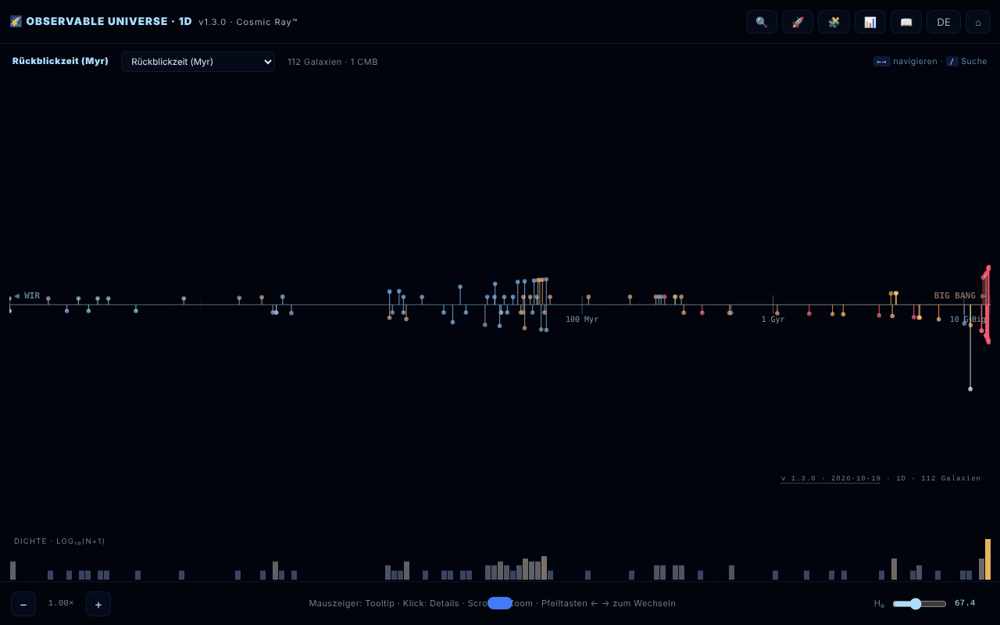

# Observable Universe 1D · The Cosmic Ray™

[English](README.md) · [Română](README.ro.md) · [Français](README.fr.md) · [Italiano](README.it.md) · [Español](README.es.md) · [Português](README.pt.md) · **Deutsch** · [Magyar](README.hu.md)

**Version:** 2.1.2 · **Zuletzt aktualisiert:** 2026-10-28

**Status:** stabil · **Offline:** vollständig

Oberflächensprachen: **Română, English, Français, Italiano, Español, Português (PT), Deutsch, Magyar**

1D-Karte des beobachtbaren Universums: 112 Galaxien, projiziert auf eine einzige radiale Achse.

**Online-App:** https://chiuta.github.io/Universul-Observabil-1D/

## Was es ist

Eine Visualisierung in einer einzigen HTML-Datei (v1.3.1), die 112 Galaxien nach Entfernung auf einer einzigen Achse anordnet – die „ehrlichste“ Projektion des Universums: ohne Winkelverzerrung, aber mit Galaxien in derselben Richtung, die im selben Punkt übereinanderliegen. Es ist die 1D-Variante, Begleiterin der 2D- und 3D-Versionen. Die Daten verwenden die ΛCDM-Kosmologie von Planck 2018 (H₀ = 67,4 km/s/Mpc); die Anwendung bezeichnet sich als „lehrreich“, mit ironischem Ton in einigen Texten (sie ist keine wissenschaftliche Publikation); die Werte sind gerundet oder angenähert, gemäß den Quellen unter Credits. Die Oberfläche hat 8 Sprachen (RO, EN, FR, IT, ES, PT, DE, HU); die Seite startet in der Browsersprache, sonst auf Englisch.

**Sprachen:** der gesamte Text (Anleitung, geführte Tour mit ihren 8 Stationen, Quiz mit Optionen und Erklärungen, Beschreibungen der 112 Galaxien) liegt in den 8 Sprachen vor; unverändert bleiben nur Eigennamen, zitierte Quellen und Exportformate. Die Übersetzungen sind automatisch; eine muttersprachliche Prüfung wird empfohlen, besonders für die astronomische Terminologie.

## Funktionen

- Vier Achsenmodi: Rückblickzeit (Lookback Time), mitbewegte Entfernung, Rotverschiebung (z) und Skalenfaktor (a = 1/(1+z)).
- Logarithmisches Histogramm der Galaxiendichte.
- Zoom auf der Achse, Tooltip beim Überfahren, Detailfenster beim Klick auf eine Galaxie.
- **Datentabelle** (📊 oder Taste `D`): alle 112 Galaxien mit Entfernung, z, Lookback und mitbewegter Entfernung, berechnet mit dem aktuellen H₀; sortierbare Spalten, Filter nach Name/Typ, CSV-Export (`observable-universe-1d-h0-<H₀>.csv`). Sie ist zugleich die barrierefreie Alternative zur Karte (Screenreader, Tastaturnavigation).
- Galaxiensuche (🔍), geführte Tour (🚀), kosmisches Quiz mit 10 Fragen und Punktzahl (🧩), Leitfaden mit den Abschnitten Intro, Navigation, Axis Modes, Why 1D?, Terms, Limits, Changelog, Credits (📖).
- RO-/EN-Schaltfläche für die Sprache und ⌂ zum Zurücksetzen der Ansicht.
- „SHARE“ erzeugt einen dauerhaften Link mit dem Ansichtszustand im URL-Fragment (`#s=`); „COPY“ kopiert den Text in die Zwischenablage.
- In der Seite erklärte Barrierefreiheit: beachtet `prefers-reduced-motion`, Modus für Farbfehlsichtigkeit, Tastaturnavigation.

## Bedienungsanleitung

1. Öffne die Seite; wähle den Achsenmodus in der Kopfzeile der Karte (lookback time, comoving distance, redshift, scale factor) — die Taste `M` schaltet sie der Reihe nach durch.
2. Navigation: Mausrad oder `+` / `-` zum Zoomen, Pfeile links/rechts, um von einer Galaxie zur nächsten zu wechseln, Klick auf eine Galaxie für Details.
3. Suche: drücke 🔍, die Taste `/` oder `Strg/Cmd+K`; die Pfeile hoch/runter wählen das Ergebnis, `Enter` bestätigt es.
4. Die Tasten `G` (Leitfaden), `T` (Tour), `Q` (Quiz), `D` (Datentabelle), `L` (Sprache), `Esc` (Fenster schließen).
5. Im Fenster einer Galaxie drücke „SHARE“ für einen Link oder „COPY“ für Text.
6. Die Schaltfläche ⌂ setzt die Ansicht zurück.

## Datenschutz und Netzwerk

- Lokal: Einstellungen werden in `localStorage` gespeichert (Schlüssel `universul-observabil-1d.prefs`). Der Teilen-Link speichert den Zustand nur in der URL.
- Netzwerk: Ich habe keine `fetch`-Aufrufe und keine externen Skripte oder Schriften gefunden; die Galaxiendaten sind in der Datei enthalten. Die Unterstützungs- und Credit-Links (alexio.tf, Buy Me a Coffee) öffnen sich nur per Klick.
- Im Leitfaden nennt der Credits-Abschnitt als Datenquellen: Planck 2018, NASA/IPAC NED, SIMBAD, JWST/JADES und Naidu et al. 2025. Sie werden zur Laufzeit nicht abgefragt.

## Lokale Ausführung / offline

Lade `index.html` herunter und öffne sie in einem Browser; sie funktioniert ohne Internet.

## Lizenz

MIT — siehe Datei LICENSE

## Katalog-Größen in der Serie (2.0.1)

- **Zahlen.** Hub: 112 Einträge (identische Kopie des 1D-Katalogs). 1D: 112. 2D: 112 (111 Galaxien + der CMB-Horizont; manche Texte sagen 111). 3D: 118 („über 115“ in den Beschreibungen). Die Zahlen unterscheiden sich, weil die Kataloge getrennt sind, nicht wegen eines Zählfehlers.
- **Nicht vereinheitlicht.** 3D hat einen eigenen Katalog mit anderer Struktur (RA in Stunden, andere Namen und Schreibweisen), seine Namen stimmen daher nur teilweise mit 1D/2D überein. Eine Zusammenführung in eine gemeinsame Datei erfolgte nicht: Jede App ist eine einzelne Offline-Datei ohne gemeinsamen Build-Schritt, und ein Zusammenführen würde Daten in drei Apps ändern, ohne sie hier validieren zu können. Dem Autor gemeldet.
- **Konflikt 1D ↔ 2D (gelöst am 2026-10-28; Quellen und Formeln in `docs/DISCREPANTE.md` des Hubs).** Die 8 Entfernungen (NGC 1132, IC 310, 3C 48, Abell 370, CL 0024+1654, SDSS J1004+4112, IC 4296, Abell 1689) folgen jetzt in beiden Apps einer Konvention: d = lb = lookback(z), in Mio. Lj, flaches ΛCDM Planck 2018 (H₀ = 67,4, Ωm = 0,315), mit von mindestens 2 Quellen bestätigtem z; 2D übernahm die 1D-Werte (330, 270, 4150, 4200, 4400, 10050, 180, 2330). Die Rotverschiebung von Andromeda (M31) ist in beiden −0,001 (M31 ist blauverschoben, −301 km/s). Die Bezeichnung „Perseus (BCG IC 310)“ wurde zu „IC 310 (Perseus)“: IC 310 ist nicht die hellste Galaxie des Haufens (das ist NGC 1275, ein eigener Eintrag).

## JWST-Rekorde erneut geprüft (27.10.2026)

- **MoM-z14:** z = 14,44, weiterhin die am weitesten entfernte spektroskopisch bestätigte Galaxie (Naidu et al., arXiv:2505.11263; veröffentlicht im Open Journal of Astrophysics, Jan. 2026).
- **JADES-GS-z14-0:** NIRSpec z = 14,32 (+0,08/−0,20) (Carniani et al. 2024, Nature); ALMA [OIII] 88 µm z = 14,1793 ± 0,0007 (Schouws et al. 2025, arXiv:2409.20549), damit vereinbar. Der Katalog behält den NIRSpec-Wert; der ALMA-Wert steht in der Beschreibung.
- **PAN-z14-1:** z = 13,53 (+0,05/−0,06), JWST/NIRSpec (Donnan et al., arXiv:2601.11515, Jan. 2026): viertentfernteste, kein Rekord. Nicht in den Katalog aufgenommen (Koordinaten ungeprüft), nur in der MoM-z14-Notiz erwähnt.

## JWST notes in 8 languages and discrepancies (2.1.0)

_(English only; not yet translated into this language. Machine translation intentionally not added to avoid errors in technical statements.)_

- The JWST notes re-checked on 27 Oct 2026 (ALMA [OIII] 88 µm for JADES-GS-z14-0, z = 14.1793; PAN-z14-1 in the MoM-z14 note) now also exist in fr/it/es/pt/de/hu as **machine translations marked in the text**; translation keys were not modified (`tests/jwst-notes.test.mjs`).
- The discrepancies against 2D (8 distances, the sign of Andromeda's z) are in a generated table: [`docs/DISCREPANTE.md`](docs/DISCREPANTE.md). **No value was chosen** (NED/SIMBAD unreachable in the session); the 1D values match the lookback computed from the catalogue's own z, which is **not a source**.
- Merging the catalogues into one shared file: not done (it would have required choosing between conflicting values).

## Verlauf / Changelog

### 2.1.2 — 2026-10-28
- Katalogentfernungen an z und Quellen angeglichen (Review 4): 3C 273 2.440→2.050, Mrk 421 397→430, 3C 279 5.800→5.470, PKS 2155-304 1.400→1.550, TON 618 10.400→10.840, MACS J0025 5.200→5.810, NGC 1277 220→240 Mly (z 0,0169). „RXCJ0232 (Pandora)“ vermischte zwei Haufen: jetzt „Abell 2744 (Pandora)“ (RA 3,59°, Dek −30,4°, z 0,308, 3.620 Mly; Übersetzungsschlüssel umbenannt). Stephans Quintett, NGC 4874 und Arp 220 sind geprüft und unverändert; NGC 1275 bleibt ungelöst (eine Quelle). Details und URLs: `docs/DISCREPANTE.md`.

### 2.1.1 — 2026-10-28
- Bezeichnung „Perseus (BCG IC 310)“ → „IC 310 (Perseus)“ (IC 310 ist nicht die BCG; Übersetzungsschlüssel in allen Sprachen umbenannt); die 1D-Entfernungen sind durch Quellen bestätigt (`docs/DISCREPANTE.md`); Tests `tests/catalog.test.mjs` und `tests/blueshift.test.mjs`.

### 2.1.0 — 2026-10-27
- JWST notes machine-translated into 6 languages; `docs/DISCREPANTE.md`.

### 1.3.10 — 2026-10-23
- Robustheit: beschädigte Einstellungen in `localStorage` (z. B. `null`) werden ignoriert, statt den Start zu blockieren; die im Titel, im Leitfaden und im Selbsttest angezeigte Version ist wieder die echte.

### 1.3.9 — 2026-10-23
- fff-kit 1.2.0: Der Schlüssel der Einstellungen lautet jetzt `universul-observabil-1d.prefs`; der alte `uv1d_prefs_v1` wird beim Start automatisch migriert, auch nach dem Import einer alten .fff.json-Sicherung. Die Ausweichlösung „Link / Details kopieren“ nutzt nicht mehr das native Browser-Fenster, sondern einen barrierefreien Dialog.

### 1.3.6 — 2026-10-22
- fff-kit 1.1.4: Touch-Ziele und Mindestschriftgröße; Touch-Ziele/Text korrigiert

### 1.3.5 — 2026-10-22
- fff-kit 1.1.2: PBKDF2 mit 600.000 Iterationen, Schutz vor Clickjacking.

### 1.3.4 — 2026-10-22
- Barrierefreiheit: Die Seite hat jetzt genau eine H1 (die Titelleiste), und das Galaxiensuchfeld hat einen Namen, den Screenreader ansagen (8 Sprachen).
- Mobil: Die Zurücksetzen-Schaltfläche und der Hubble-Konstanten-Regler haben größere Touch-Flächen.
- Die Detailleiste ist für Tastatur und Screenreader verborgen, solange sie geschlossen ist (kein Inhalt mehr außerhalb des Bildschirms).

- **1.3.3 — 2026-10-22:** das Filterfeld der Datentabelle (Platzhalter und Barrierefreiheits-Label) wird von Anfang an übersetzt, nicht erst nach dem Öffnen der Tabelle.
- 1.3.2 — 2026-10-22: Namen der Galaxien und Objekte in allen 8 Sprachen lokalisiert (Milchstraße, Feuerrad, Strudel usw. bleiben nicht mehr rumänisch); Seitentitel und Meta-Beschreibungen folgen der Oberflächensprache.

- 1.3.1 — 2026-10-19: Anleitung, geführte Tour, Quiz (alle 12 Fragetypen, Optionen und Erklärungen) und die 112 Galaxienbeschreibungen sind nach fr, it, es, pt, de, hu übersetzt; die Aussage, die langen Texte „bleiben auf ro/en“, wurde entfernt.
- 1.2.0 — 2026-10-19: Schaltfläche „🗺️ 2D-KARTE ↗“ im Galaxienfenster (dieselbe Galaxie, aktuelle Sprache); der Permalink `#s=` akzeptiert den Guard `gn`.

- 1.1.0 — 2026-10-14: Datensicherung und Datenkennzeichnung (fff-kit).

- 1.0.4 — 2026-10-12: Version und Datum der letzten Aktualisierung werden in der App angezeigt.

v1.0.3 (11. Oktober 2026):
- Behoben: `Esc` schloss das Quiz nicht (jetzt schon; das Quiz lässt sich auch per Tastatur spielen: `1`–`4`, Tab + Enter, Fokus korrekt verschoben); die Datentabelle und das Detailfenster behielten nach dem Verschieben des Reglers das alte H₀ (jetzt aktualisieren sie sich sofort); im RO-Modus zeigte das Detailfenster auch die Beschreibung auf Englisch (jetzt nur eine Sprache, mit RO-Rückfall für Einträge ohne EN-Text); „CMB · kosmologischer Horizont“ übersetzt.
- Katalogentfernungen mit z in Einklang gebracht, gleiche Methode wie in v1.0.2: IC 4296 (130 → ≈ 180 Mio. Lj), 3C 48 (5 200 → ≈ 4 150 Mio. Lj), Abell 370 (5 900 → ≈ 4 200 Mio. Lj), CL 0024+1654 (5 500 → ≈ 4 400 Mio. Lj). Andere Einträge mit kleineren Abweichungen (z. B. 3C 273) bleiben bei den Katalogwerten.
- CSP-Hash neu berechnet; axe-core = 0 Verstöße bei 1280 und 360 px.

v1.0.2 (11. Oktober 2026):
- Neu: sortier-/filterbare Datentabelle mit CSV-Export (siehe „Funktionen“).
- Katalogentfernungen mit der veröffentlichten Rotverschiebung in Einklang gebracht für vier Einträge mit inkonsistenten Werten: NGC 1132 (z = 0,0232: 1 020 → ≈ 330 Mio. Lj), Perseus / IC 310 (z = 0,0189: 780 → ≈ 270 Mio. Lj), Abell 1689 (z = 0,183: 7 200 → ≈ 2 330 Mio. Lj), SDSS J1004+4112 (z = 1,734: 7 000 → ≈ 10 050 Mio. Lj). Die Werte sind die Rückblickzeit bei z in der ΛCDM-Kosmologie der Anwendung (H₀ = 67,4); die z-Werte wurden am 11.10.2026 bestätigt (Wikipedia für NGC 1132 und Abell 1689, Inada et al. 2003 für SDSS J1004+4112). Andere Einträge (z. B. Abell 370, 3C 48) haben Entfernungen, die vom Lookback bei z um 20–40 % abweichen, liegen aber zwischen Lookback und mitbewegter Entfernung und wurden daher nicht geändert.
- CSP: Das Skript wird jetzt per Hash erlaubt (`script-src 'sha256-…'`), ohne `'unsafe-inline'`; die Anwendung hat keine Inline-Handler.

v1.0.1 (11. Oktober 2026):
- Korrekte abgeleitete Werte für nahe Galaxien (d < 100 Mio. Lj): Andromeda zeigt jetzt Lookback ≈ 2,5 Mio. Jahre und mitbewegt ≈ 2,5 Mio. Lj (vorher 14 Mio. Jahre / 15 Mio. Lj, aus z abgeleitet); z = −0,001 (Blauverschiebung), nicht +0,001. Die Positionen auf der Achse verwenden dieselben Werte.
- Typbezeichnung auf Rumänisch: „Spirală galaxie“ statt „SPIRALĂ GALAXY“.
- Die Achsenbeschriftungen haben eine Kontur; Kopfzeile und Spenden-Widget verdecken die Bedienelemente bei 360 px nicht mehr. axe-core = 0 Verstöße (einschließlich `region`).
- Die Rotverschiebungsrekorde bleiben die „zum Katalogdatum (Mai 2026)“; eine Websuche am 11.10.2026 fand keinen neueren spektroskopischen Rekord als MoM-z14 (z = 14,44), der Katalog wurde jedoch nicht systematisch erneut geprüft.

## Autor

Alexio — Alexandru-Ionuț Chiuță, Kontakt: alexio@trom.tf. Die Anwendung nennt in ihren Credits auch das Centrul StrING.

## Audit

Audit: 2026-10-10; Runde 2: 2026-10-11 — das Feld „DOI“ mit fiktivem Wert aus der Zitation entfernt (es gibt keinen echten DOI); die Angabe „satirisch und lehrreich“ / „alle Daten sind korrekt“ umformuliert (RO+EN-Leitfaden und README). Viewport und Kontrast in Runde 1 korrigiert. Runde 3 (2026-10-11): vergängliche Aussagen („absoluter/aktueller Rekord“, „NEU“, „nächste/fernste“) als „zum Katalogdatum (Mai 2026)“ umformuliert, mit Quelle (Naidu et al. 2025 für MoM-z14; arXiv 2603.15841 für EGS-z11-R0). Rekorde können nach diesem Datum übertroffen werden.

## Zusammenfassung
Eine 1D-Karte des beobachtbaren Universums in einer einzigen Datei: 112 Galaxien auf einer radialen Achse, umschaltbar zwischen Rückblickzeit, mitbewegter Entfernung, Rotverschiebung und Skalenfaktor, mit logarithmischem Dichtehistogramm, Suche, geführter Tour, Quiz mit 10 Fragen, einer Oberfläche in 8 Sprachen und teilbaren Permalinks. Einstellungen werden in localStorage gespeichert; im Code wurden keine externen Anfragen gefunden. MIT-Lizenz.
