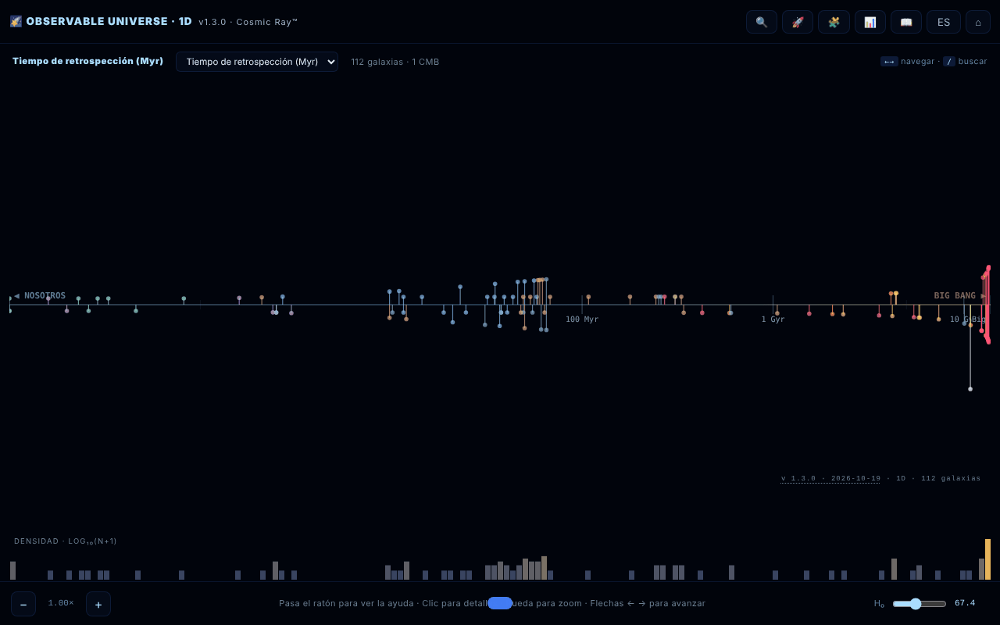

# Observable Universe 1D · The Cosmic Ray™

[English](README.md) · [Română](README.ro.md) · [Français](README.fr.md) · [Italiano](README.it.md) · **Español** · [Português](README.pt.md) · [Deutsch](README.de.md) · [Magyar](README.hu.md)

**Versión:** 1.3.4 · **Última actualización:** 2026-10-22

Idiomas de la interfaz: **Română, English, Français, Italiano, Español, Português (PT), Deutsch, Magyar**

Mapa 1D del universo observable: 112 galaxias proyectadas sobre un único eje radial.

**Aplicación en línea:** https://chiuta.github.io/Universul-Observabil-1D/

## Qué es

Una visualización en un solo archivo HTML (v1.3.1) que coloca 112 galaxias sobre un único eje según la distancia, la proyección «más honesta» del universo: sin distorsiones angulares, pero con las galaxias situadas en la misma dirección superpuestas en el mismo punto. Es la versión 1D, compañera de las versiones 2D y 3D. Los datos usan la cosmología ΛCDM de Planck 2018 (H₀ = 67,4 km/s/Mpc); la aplicación se describe como «educativa», con un tono irónico en algunos textos (no es una publicación científica); los valores están redondeados o son aproximados, según las fuentes de los Créditos. La interfaz tiene 8 idiomas (RO, EN, FR, IT, ES, PT, DE, HU); la página arranca en el idioma del navegador y, si no, en inglés.

**Idiomas:** todo el texto (guía, visita guiada con sus 8 paradas, cuestionario con opciones y explicaciones, descripciones de las 112 galaxias) está disponible en los 8 idiomas; solo permanecen sin cambios los nombres propios, las fuentes citadas y los formatos de exportación. Las traducciones son automáticas; se recomienda una revisión nativa, sobre todo de la terminología astronómica.

## Funciones

- Cuatro modos de eje: tiempo de retrospección (lookback time), distancia comóvil, corrimiento al rojo (z) y factor de escala (a = 1/(1+z)).
- Histograma logarítmico de la densidad de galaxias.
- Zoom sobre el eje, información emergente al pasar el ratón, panel de detalles al hacer clic en una galaxia.
- **Tabla de datos** (📊 o tecla `D`): las 112 galaxias con distancia, z, lookback y distancia comóvil calculados con el H₀ actual; columnas ordenables, filtro por nombre/tipo, exportación CSV (`observable-universe-1d-h0-<H₀>.csv`). Es también la alternativa accesible al mapa (lectores de pantalla, navegación con teclado).
- Búsqueda de galaxias (🔍), recorrido guiado (🚀), cuestionario cósmico de 10 preguntas con puntuación (🧩), guía con las secciones Intro, Navigation, Axis Modes, Why 1D?, Terms, Limits, Changelog, Credits (📖).
- Selector de idioma y ⌂ para restablecer la vista.
- «SHARE» genera un enlace permanente con el estado de la vista en el fragmento de la URL (`#s=`); «COPY» copia el texto al portapapeles.
- Accesibilidad declarada en la página: respeta `prefers-reduced-motion`, modo para daltonismo, navegación con teclado.

## Guía de uso

1. Abre la página; elige el modo de eje en la cabecera del mapa (lookback time, comoving distance, redshift, scale factor) — la tecla `M` los recorre por turno.
2. Navega: rueda del ratón o `+` / `-` para el zoom, flechas izquierda/derecha para pasar de una galaxia a otra, clic en una galaxia para ver los detalles.
3. Búsqueda: pulsa 🔍, la tecla `/` o `Ctrl/Cmd+K`; las flechas arriba/abajo eligen el resultado, `Enter` lo selecciona.
4. Las teclas `G` (guía), `T` (recorrido), `Q` (cuestionario), `D` (tabla de datos), `L` (idioma), `Esc` (cierra los paneles).
5. En el panel de una galaxia pulsa «SHARE» para el enlace o «COPY» para el texto.
6. El botón ⌂ restablece la vista.

## Privacidad y red

- Local: las preferencias se guardan en `localStorage` (clave `uv1d_prefs_v1`). El enlace para compartir almacena el estado solo en la URL.
- Red: no encontré llamadas `fetch` ni scripts o fuentes externos; los datos de las galaxias están incluidos en el archivo. Los enlaces de apoyo y de crédito (alexio.tf, Buy Me a Coffee) solo se abren si haces clic en ellos.
- En la guía, la sección de créditos menciona como fuentes de datos: Planck 2018, NASA/IPAC NED, SIMBAD, JWST/JADES y Naidu et al. 2025. No se consultan durante la ejecución.

## Ejecución local / offline

Descarga `index.html` y ábrelo en un navegador; funciona sin internet.

## Licencia

MIT — véase el archivo LICENSE

## Historial / Changelog

### 1.3.4 — 2026-10-22
- Accesibilidad: la página tiene ahora exactamente un H1 (la barra de título) y el campo de búsqueda de galaxias tiene un nombre que anuncian los lectores de pantalla (8 idiomas).
- Móvil: el botón de restablecer y el control deslizante de la constante de Hubble tienen áreas táctiles mayores.
- El panel de detalles queda oculto al teclado y a los lectores de pantalla mientras está cerrado (ya no hay contenido fuera de pantalla).

- **1.3.3 — 2026-10-22:** el campo de filtro de la tabla de datos (texto de ejemplo y etiqueta de accesibilidad) se traduce desde el inicio, no solo al abrir la tabla.
- 1.3.2 — 2026-10-22: nombres de galaxias y objetos localizados en los 8 idiomas (Vía Láctea, Molinete, Remolino, etc. ya no quedan en rumano); el título de la página y las metadescripciones siguen el idioma de la interfaz.

- 1.3.1 — 2026-10-19: la guía, la visita guiada, el cuestionario (los 12 tipos de preguntas, opciones y explicaciones) y las 112 descripciones de galaxias están traducidos a fr, it, es, pt, de, hu; se eliminó la afirmación de que los textos largos «permanecen en ro/en».
- 1.2.0 — 2026-10-19: botón «🗺️ MAPA 2D ↗» en el panel de la galaxia (la misma galaxia, idioma actual); el permalink `#s=` acepta la guarda `gn`.

- 1.1.0 — 2026-10-14: copia de seguridad y etiquetado de datos (fff-kit).

- 1.0.4 — 2026-10-12: la versión y la fecha de la última actualización se muestran en la aplicación.

v1.0.3 (11 de octubre de 2026):
- Corregido: `Esc` no cerraba el cuestionario (ahora lo cierra; el cuestionario también puede jugarse con el teclado: `1`–`4`, Tab + Enter, foco movido correctamente); la tabla de datos y el panel de detalles conservaban el H₀ antiguo tras mover el deslizador (ahora se actualizan de inmediato); en modo RO el panel de detalles mostraba también la descripción en inglés (ahora un solo idioma, con respaldo RO para las entradas sin texto EN); «CMB · horizonte cosmológico» traducido.
- Distancias del catálogo ajustadas a z, mismo método que en la v1.0.2: IC 4296 (130 → ≈ 180 Mal), 3C 48 (5 200 → ≈ 4 150 Mal), Abell 370 (5 900 → ≈ 4 200 Mal), CL 0024+1654 (5 500 → ≈ 4 400 Mal). Otras entradas con desviaciones menores (p. ej. 3C 273) permanecen en los valores del catálogo.
- Hash CSP recalculado; axe-core = 0 infracciones a 1280 y 360 px.

v1.0.2 (11 de octubre de 2026):
- Nuevo: tabla de datos ordenable/filtrable con exportación CSV (véase «Funciones»).
- Distancias del catálogo ajustadas al corrimiento al rojo publicado para cuatro entradas con valores incoherentes: NGC 1132 (z = 0,0232: 1 020 → ≈ 330 Mal), Perseus / IC 310 (z = 0,0189: 780 → ≈ 270 Mal), Abell 1689 (z = 0,183: 7 200 → ≈ 2 330 Mal), SDSS J1004+4112 (z = 1,734: 7 000 → ≈ 10 050 Mal). Los valores son el tiempo de retrospección a z en la cosmología ΛCDM de la aplicación (H₀ = 67,4); los z se confirmaron el 11.10.2026 (Wikipedia para NGC 1132 y Abell 1689, Inada et al. 2003 para SDSS J1004+4112). Otras entradas (p. ej. Abell 370, 3C 48) tienen distancias que difieren del lookback a z entre un 20 y un 40 %, pero quedan entre el lookback y la distancia comóvil, por lo que no se modificaron.
- CSP: el script se permite ahora mediante hash (`script-src 'sha256-…'`), sin `'unsafe-inline'`; la aplicación no tiene manejadores en línea.

v1.0.1 (11 de octubre de 2026):
- Valores derivados correctos para galaxias cercanas (d < 100 Mal): Andrómeda muestra ahora lookback ≈ 2,5 Man y distancia comóvil ≈ 2,5 Mal (antes 14 Man / 15 Mal, derivados de z); z = −0,001 (corrimiento al azul), no +0,001. Las posiciones sobre el eje usan los mismos valores.
- Etiqueta de tipo en rumano: «Spirală galaxie» en lugar de «SPIRALĂ GALAXY».
- Las etiquetas del eje tienen contorno; la cabecera y el widget de donaciones ya no cubren los controles a 360 px. axe-core = 0 infracciones (incluida `region`).
- Los récords de corrimiento al rojo siguen siendo los «a la fecha del catálogo (mayo de 2026)»; una búsqueda web del 11.10.2026 no encontró un récord espectroscópico más reciente que MoM-z14 (z = 14,44), pero el catálogo no se reverificó sistemáticamente.

## Autor

Alexio — Alexandru-Ionuț Chiuță, contacto: alexio@trom.tf. La aplicación menciona también al Centrul StrING en sus créditos.

## Auditoría

Auditoría: 2026-10-10; ronda 2: 2026-10-11 — eliminado de la cita el campo «DOI» con valor ficticio (no existe un DOI real); reformulada la mención «satírico y educativo» / «todos los datos son correctos» (guía RO+EN y README). Viewport y contraste corregidos en la ronda 1. Ronda 3 (2026-10-11): las afirmaciones perecederas («récord absoluto/actual», «NUEVO», «la más cercana/lejana») reformuladas como «a la fecha del catálogo (mayo de 2026)», con la fuente (Naidu et al. 2025 para MoM-z14; arXiv 2603.15841 para EGS-z11-R0). Los récords pueden ser superados después de esta fecha.

## Resumen

Un mapa 1D del universo observable en un solo archivo: 112 galaxias sobre un único eje radial, conmutable entre tiempo de retrospección, distancia comóvil, corrimiento al rojo y factor de escala, con histograma logarítmico de densidad, búsqueda, recorrido guiado, cuestionario de 10 preguntas, interfaz en 8 idiomas y permalinks compartibles. Las preferencias se guardan en localStorage; no se encontraron solicitudes externas en el código. Licencia MIT.
