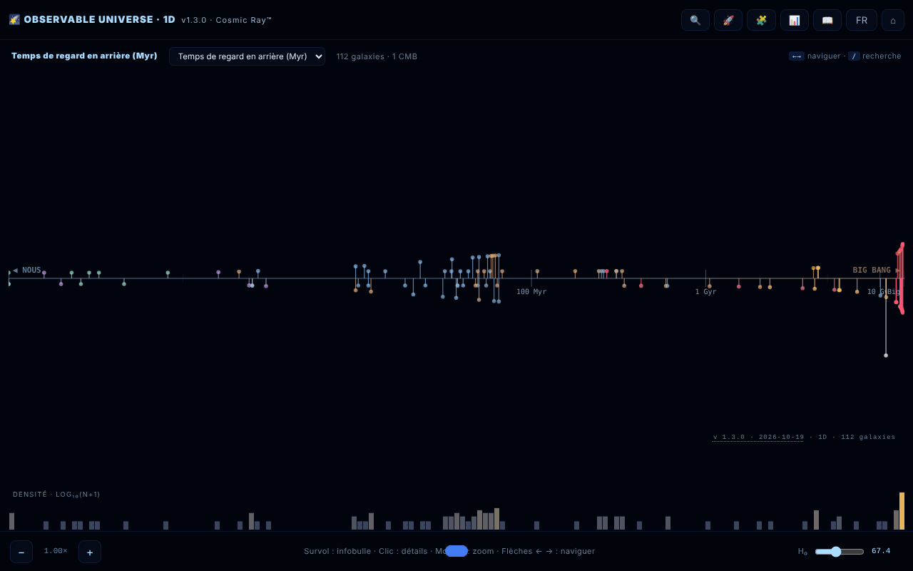

# Observable Universe 1D · The Cosmic Ray™

[English](README.md) · [Română](README.ro.md) · **Français** · [Italiano](README.it.md) · [Español](README.es.md) · [Português](README.pt.md) · [Deutsch](README.de.md) · [Magyar](README.hu.md)

**Version :** 1.3.6 · **Dernière mise à jour :** 2026-10-22

Langues de l'interface : **Română, English, Français, Italiano, Español, Português (PT), Deutsch, Magyar**

Carte 1D de l'univers observable : 112 galaxies projetées sur un seul axe radial.

**Application en ligne :** https://chiuta.github.io/Universul-Observabil-1D/

## Présentation

Une visualisation dans un seul fichier HTML (v1.3.1) qui place 112 galaxies sur un seul axe en fonction de la distance, la projection « la plus honnête » de l'univers : sans distorsion angulaire, mais avec les galaxies situées dans la même direction superposées au même point. C'est la version 1D, compagne des versions 2D et 3D. Les données reposent sur la cosmologie ΛCDM de Planck 2018 (H₀ = 67,4 km/s/Mpc) ; l'application se décrit comme « éducative », avec un ton ironique dans certains textes (ce n'est pas une publication scientifique) ; les valeurs sont arrondies ou approximatives, d'après les sources indiquées dans les Crédits. L'interface compte 8 langues (RO, EN, FR, IT, ES, PT, DE, HU) ; la page démarre dans la langue du navigateur, sinon en anglais.

**Langues :** tout le texte (guide, visite guidée avec ses 8 étapes, quiz avec options et explications, descriptions des 112 galaxies) est disponible dans les 8 langues ; seuls les noms propres, les sources citées et les formats d'export restent tels quels. Les traductions sont automatiques ; une relecture native est recommandée, surtout pour la terminologie astronomique.

## Fonctionnalités

- Quatre modes d'axe : temps de regard en arrière (lookback time), distance comobile, décalage vers le rouge (z) et facteur d'échelle (a = 1/(1+z)).
- Histogramme logarithmique de la densité des galaxies.
- Zoom sur l'axe, infobulle au survol, panneau de détails au clic sur une galaxie.
- **Tableau de données** (📊 ou touche `D`) : les 112 galaxies avec distance, z, lookback et distance comobile calculés avec le H₀ courant ; colonnes triables, filtre par nom/type, export CSV (`observable-universe-1d-h0-<H₀>.csv`). C'est aussi l'alternative accessible à la carte (lecteurs d'écran, navigation au clavier).
- Recherche de galaxies (🔍), visite guidée (🚀), quiz cosmique de 10 questions avec score (🧩), guide avec les sections Intro, Navigation, Axis Modes, Why 1D?, Terms, Limits, Changelog, Credits (📖).
- Sélecteur de langue et ⌂ pour réinitialiser la vue.
- « SHARE » génère un lien permanent avec l'état de la vue dans le fragment d'URL (`#s=`) ; « COPY » copie le texte dans le presse-papiers.
- Accessibilité déclarée dans la page : respecte `prefers-reduced-motion`, mode daltonien, navigation au clavier.

## Mode d'emploi

1. Ouvrez la page ; choisissez le mode d'axe dans l'en-tête de la carte (lookback time, comoving distance, redshift, scale factor) — la touche `M` les parcourt tour à tour.
2. Naviguez : molette de la souris ou `+` / `-` pour zoomer, flèches gauche/droite pour passer d'une galaxie à l'autre, clic sur une galaxie pour les détails.
3. Recherche : appuyez sur 🔍, sur la touche `/` ou sur `Ctrl/Cmd+K` ; les flèches haut/bas choisissent le résultat, `Entrée` le sélectionne.
4. Les touches `G` (guide), `T` (visite), `Q` (quiz), `D` (tableau de données), `L` (langue), `Échap` (ferme les panneaux).
5. Dans le panneau d'une galaxie, appuyez sur « SHARE » pour un lien ou sur « COPY » pour le texte.
6. Le bouton ⌂ réinitialise la vue.

## Confidentialité et réseau

- Local : les préférences sont conservées dans `localStorage` (clé `uv1d_prefs_v1`). Le lien de partage ne stocke l'état que dans l'URL.
- Réseau : je n'ai trouvé aucun appel `fetch`, ni script ou police externe ; les données des galaxies sont incluses dans le fichier. Les liens de soutien et de crédit (alexio.tf, Buy Me a Coffee) ne s'ouvrent que si vous cliquez dessus.
- Dans le guide, la section des crédits mentionne comme sources de données : Planck 2018, NASA/IPAC NED, SIMBAD, JWST/JADES et Naidu et al. 2025. Elles ne sont pas interrogées à l'exécution.

## Exécution locale / hors ligne

Téléchargez `index.html` et ouvrez-le dans un navigateur ; il fonctionne sans internet.

## Licence

MIT — voir le fichier LICENSE

## Historique / Changelog

### 1.3.6 — 2026-10-22
- fff-kit 1.1.4 : cibles tactiles et taille de texte minimale; cibles tactiles/texte corrigés

### 1.3.5 — 2026-10-22
- fff-kit 1.1.2 : PBKDF2 à 600 000 itérations, protection anti-clickjacking.

### 1.3.4 — 2026-10-22
- Accessibilité : la page comporte désormais exactement un H1 (la barre de titre) et le champ de recherche de galaxies a un nom annoncé par les lecteurs d'écran (8 langues).
- Mobile : le bouton de réinitialisation et le curseur de la constante de Hubble ont des cibles tactiles plus grandes.
- Le tiroir de détails est masqué au clavier et aux lecteurs d'écran tant qu'il est fermé (plus de contenu hors écran).

- **1.3.3 — 2026-10-22:** le champ de filtre du tableau de données (texte indicatif et étiquette d'accessibilité) est traduit dès le départ, et non plus seulement après l'ouverture du tableau.
- 1.3.2 — 2026-10-22: noms des galaxies et objets localisés dans les 8 langues (Voie lactée, Moulinet, Tourbillon, etc. ne restent plus en roumain) ; le titre de la page et les méta-descriptions suivent la langue de l'interface.

- 1.3.1 — 2026-10-19 : le guide, la visite guidée, le quiz (les 12 types de questions, options et explications) et les 112 descriptions de galaxies sont traduits en fr, it, es, pt, de, hu ; l'affirmation selon laquelle les longs textes « restent en ro/en » a été supprimée.
- 1.2.0 — 2026-10-19 : bouton « 🗺️ CARTE 2D ↗ » dans le panneau de la galaxie (même galaxie, langue courante) ; le permalien `#s=` accepte la garde `gn`.

- 1.1.0 — 2026-10-14 : sauvegarde et étiquetage des données (fff-kit).

- 1.0.4 — 2026-10-12 : la version et la date de dernière mise à jour sont affichées dans l'application.

v1.0.3 (11 octobre 2026) :
- Corrigé : `Échap` ne fermait pas le quiz (il le ferme désormais ; le quiz peut aussi se jouer au clavier : `1`–`4`, Tab + Entrée, focus déplacé correctement) ; le tableau de données et le panneau de détails gardaient l'ancien H₀ après le déplacement du curseur (ils se mettent à jour immédiatement) ; en mode RO le panneau de détails affichait aussi la description en anglais (désormais une seule langue, avec repli RO pour les entrées sans texte EN) ; « CMB · horizon cosmologique » traduit.
- Distances du catalogue mises en accord avec z, même méthode qu'en v1.0.2 : IC 4296 (130 → ≈ 180 Mal), 3C 48 (5 200 → ≈ 4 150 Mal), Abell 370 (5 900 → ≈ 4 200 Mal), CL 0024+1654 (5 500 → ≈ 4 400 Mal). D'autres entrées à écarts plus faibles (p. ex. 3C 273) restent aux valeurs du catalogue.
- Hachage CSP recalculé ; axe-core = 0 violation à 1280 et 360 px.

v1.0.2 (11 octobre 2026) :
- Nouveau : tableau de données triable/filtrable avec export CSV (voir « Fonctionnalités »).
- Distances du catalogue mises en accord avec le décalage vers le rouge publié pour quatre entrées aux valeurs incohérentes : NGC 1132 (z = 0,0232 : 1 020 → ≈ 330 Mal), Perseus / IC 310 (z = 0,0189 : 780 → ≈ 270 Mal), Abell 1689 (z = 0,183 : 7 200 → ≈ 2 330 Mal), SDSS J1004+4112 (z = 1,734 : 7 000 → ≈ 10 050 Mal). Les valeurs sont le temps de regard en arrière à z dans la cosmologie ΛCDM de l'application (H₀ = 67,4) ; les z ont été confirmés le 11.10.2026 (Wikipedia pour NGC 1132 et Abell 1689, Inada et al. 2003 pour SDSS J1004+4112). D'autres entrées (p. ex. Abell 370, 3C 48) ont des distances qui diffèrent du lookback à z de 20 à 40 %, mais restent comprises entre le lookback et la distance comobile ; elles n'ont donc pas été modifiées.
- CSP : le script est désormais autorisé par hachage (`script-src 'sha256-…'`), sans `'unsafe-inline'` ; l'application n'a pas de gestionnaires en ligne.

v1.0.1 (11 octobre 2026) :
- Valeurs dérivées correctes pour les galaxies proches (d < 100 Mal) : Andromède affiche désormais un lookback ≈ 2,5 Man et une distance comobile ≈ 2,5 Mal (auparavant 14 Man / 15 Mal, dérivés de z) ; z = −0,001 (décalage vers le bleu), et non +0,001. Les positions sur l'axe utilisent les mêmes valeurs.
- Étiquette de type en roumain : « Spirală galaxie » au lieu de « SPIRALĂ GALAXY ».
- Les étiquettes de l'axe ont un contour ; l'en-tête et le widget de dons ne recouvrent plus les contrôles à 360 px. axe-core = 0 violation (y compris `region`).
- Les records de décalage vers le rouge restent ceux « à la date du catalogue (mai 2026) » ; une recherche web du 11.10.2026 n'a trouvé aucun record spectroscopique plus récent que MoM-z14 (z = 14,44), mais le catalogue n'a pas été revérifié systématiquement.

## Auteur

Alexio — Alexandru-Ionuț Chiuță, contact : alexio@trom.tf. L'application cite aussi le Centrul StrING dans ses crédits.

## Audit

Audit : 2026-10-10 ; tour 2 : 2026-10-11 — suppression de la citation du champ « DOI » à valeur fictive (il n'existe pas de DOI réel) ; reformulation de la mention « satirique et éducatif » / « toutes les données sont correctes » (guide RO+EN et README). Viewport et contraste corrigés au tour 1. Tour 3 (2026-10-11) : les affirmations périssables (« record absolu/actuel », « NOUVEAU », « le plus proche/le plus lointain ») reformulées en « à la date du catalogue (mai 2026) », avec la source (Naidu et al. 2025 pour MoM-z14 ; arXiv 2603.15841 pour EGS-z11-R0). Les records peuvent être dépassés après cette date.

## Résumé
Une carte 1D de l'univers observable en un seul fichier : 112 galaxies sur un axe radial unique, commutable entre temps de regard en arrière, distance comobile, décalage vers le rouge et facteur d'échelle, avec histogramme logarithmique de densité, recherche, visite guidée, quiz de 10 questions, interface en 8 langues et permaliens partageables. Les préférences sont conservées dans localStorage ; aucune requête externe n'a été trouvée dans le code. Licence MIT.
