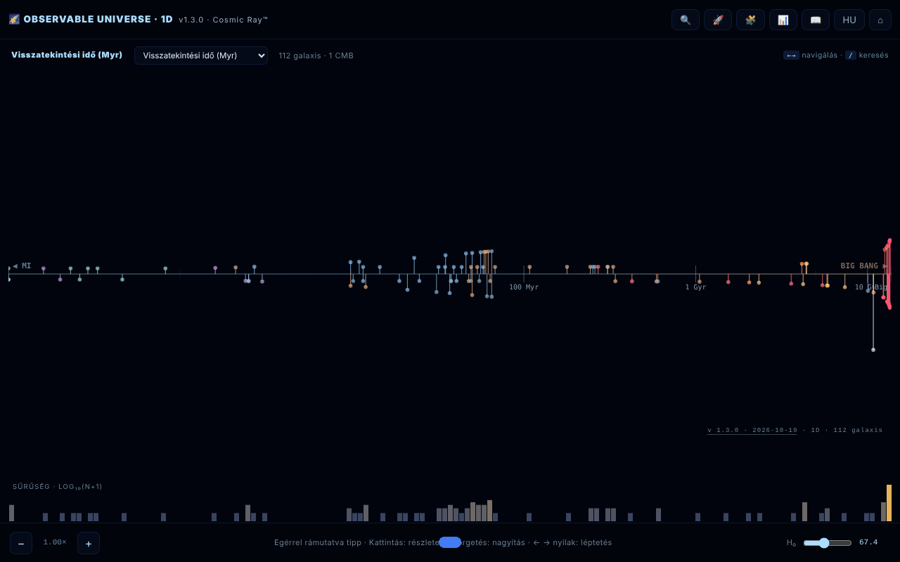

# Observable Universe 1D · The Cosmic Ray™

[English](README.md) · [Română](README.ro.md) · [Français](README.fr.md) · [Italiano](README.it.md) · [Español](README.es.md) · [Português](README.pt.md) · [Deutsch](README.de.md) · **Magyar**

**Verzió:** 2.1.1 · **Utolsó frissítés:** 2026-10-28

**Állapot:** stabil · **Offline:** teljes

A felület nyelvei: **Română, English, Français, Italiano, Español, Português (PT), Deutsch, Magyar**

A megfigyelhető univerzum 1D-s térképe: 112 galaxis egyetlen sugárirányú tengelyre vetítve.

**Online alkalmazás:** https://chiuta.github.io/Universul-Observabil-1D/

## Mi ez

Egyetlen HTML-fájlból álló vizualizáció (v1.3.1), amely 112 galaxist helyez el egyetlen tengelyen a távolságuk szerint – az univerzum „legőszintébb” vetítése: szögtorzítás nélkül, de az azonos irányban lévő galaxisok ugyanabba a pontba esnek, egymásra vetülve. Ez az 1D változat, a 2D és 3D verziók társa. Az adatok a Planck 2018 ΛCDM kozmológiáját használják (H₀ = 67,4 km/s/Mpc); az alkalmazás „oktató jellegűnek” írja le magát, egyes szövegekben ironikus hangnemmel (nem tudományos publikáció); az értékek kerekítettek vagy hozzávetőlegesek, a Köszönetnyilvánításban szereplő források szerint. A felület 8 nyelvű (RO, EN, FR, IT, ES, PT, DE, HU); az oldal a böngésző nyelvén indul, egyébként angolul.

**Nyelvek:** az összes szöveg (útmutató, a 8 állomásos vezetett túra, a kvíz válaszlehetőségekkel és magyarázatokkal, a 112 galaxis leírása) mind a 8 nyelven elérhető; csak a tulajdonnevek, az idézett források és az exportformátumok maradnak változatlanul. A fordítások automatikusak; anyanyelvi lektorálás ajánlott, különösen a csillagászati szakkifejezésekhez.

## Funkciók

- Négy tengelymód: visszatekintési idő (lookback time), együttmozgó távolság, vöröseltolódás (z) és skálafaktor (a = 1/(1+z)).
- A galaxissűrűség logaritmikus hisztogramja.
- Nagyítás a tengelyen, szúrópróba-súgó (tooltip) lebegtetéskor, részletek panel egy galaxisra kattintva.
- **Adattábla** (📊 vagy a `D` billentyű): mind a 112 galaxis távolsággal, z-vel, lookback és együttmozgó értékkel, az aktuális H₀-val számolva; rendezhető oszlopok, szűrés név/típus szerint, CSV-export (`observable-universe-1d-h0-<H₀>.csv`). Egyben a térkép akadálymentes alternatívája (képernyőolvasók, billentyűzetes navigáció).
- Galaxiskeresés (🔍), vezetett túra (🚀), 10 kérdéses kozmikus kvíz pontszámmal (🧩), útmutató az Intro, Navigation, Axis Modes, Why 1D?, Terms, Limits, Changelog, Credits szakaszokkal (📖).
- Nyelvválasztó és ⌂ a nézet visszaállításához.
- A „SHARE” állandó hivatkozást hoz létre a nézet állapotával az URL töredékében (`#s=`); a „COPY” a szöveget a vágólapra másolja.
- Az oldalon deklarált hozzáférhetőség: tiszteletben tartja a `prefers-reduced-motion` beállítást, színtévesztő mód, billentyűzetes navigáció.

## Használati útmutató

1. Nyisd meg az oldalt; válaszd ki a tengelymódot a térkép fejlécében (lookback time, comoving distance, redshift, scale factor) — az `M` billentyű sorban végigléptet rajtuk.
2. Navigálás: egérgörgő vagy `+` / `-` a nagyításhoz, bal/jobb nyíl a galaxisok közti lépkedéshez, kattintás egy galaxisra a részletekért.
3. Keresés: nyomd meg a 🔍 gombot, a `/` billentyűt vagy a `Ctrl/Cmd+K` kombinációt; a fel/le nyilak választják ki az eredményt, az `Enter` megerősíti.
4. A `G` (útmutató), `T` (túra), `Q` (kvíz), `D` (adattábla), `L` (nyelv), `Esc` (panelek bezárása) billentyűk.
5. Egy galaxis paneljén nyomd meg a „SHARE” gombot hivatkozáshoz, vagy a „COPY” gombot szöveghez.
6. A ⌂ gomb visszaállítja a nézetet.

## Adatvédelem és hálózat

- Helyi: a beállítások a `localStorage`-ban tárolódnak (kulcs: `universul-observabil-1d.prefs`). A megosztási hivatkozás az állapotot csak az URL-ben tárolja.
- Hálózat: nem találtam `fetch` hívást, sem külső szkriptet vagy betűtípust; a galaxisok adatai a fájlban vannak. A támogatói és köszönetnyilvánítási hivatkozások (alexio.tf, Buy Me a Coffee) csak kattintásra nyílnak meg.
- Az útmutatóban a köszönetnyilvánítási szakasz adatforrásként a következőket említi: Planck 2018, NASA/IPAC NED, SIMBAD, JWST/JADES és Naidu et al. 2025. Futásidőben nem kérdezi le őket.

## Helyi futtatás / offline

Töltsd le az `index.html` fájlt, és nyisd meg böngészőben; internet nélkül is működik.

## Licenc

MIT — lásd a LICENSE fájlt

## A katalógusok mérete a sorozatban (2.0.1)

- **Számok.** Hub: 112 bejegyzés (az 1D katalógus azonos másolata). 1D: 112. 2D: 112 (111 galaxis + a CMB-horizont; egyes szövegek 111-et írnak). 3D: 118 (a leírásokban „több mint 115”). A számok azért térnek el, mert a katalógusok különállóak, nem számolási hiba miatt.
- **Nincs egységesítve.** A 3D saját, eltérő felépítésű katalógust használ (RA órában, más nevek és írásmódok), ezért a nevei csak részben egyeznek az 1D/2D-vel. Egyetlen közös fájlba nem vontuk össze: minden alkalmazás egyetlen offline fájl közös build-lépés nélkül, az összevonás három alkalmazás adatait módosítaná, itt nem validálható módon. Jelezve a szerzőnek.
- **1D ↔ 2D ütközés (feloldva 2026-10-28-án; források és képletek a hub `docs/DISCREPANTE.md` fájljában).** A 8 távolság (NGC 1132, IC 310, 3C 48, Abell 370, CL 0024+1654, SDSS J1004+4112, IC 4296, Abell 1689) mostantól egyetlen megállapodást követ mindkét alkalmazásban: d = lb = lookback(z), millió fényévben, lapos ΛCDM Planck 2018 (H₀ = 67,4, Ωm = 0,315), legalább 2 forrás által megerősített z-vel; a 2D átvette az 1D értékeit (330, 270, 4150, 4200, 4400, 10050, 180, 2330). Az Androméda (M31) vöröseltolódása mindkettőben −0,001 (az M31 kékeltolódású, −301 km/s). A „Perseus (BCG IC 310)” címke „IC 310 (Perseus)” lett: az IC 310 nem a halmaz legfényesebb galaxisa (az az NGC 1275, külön bejegyzés).

## JWST-rekordok újraellenőrizve (2026.10.27.)

- **MoM-z14:** z = 14,44, továbbra is a legtávolabbi spektroszkópiailag megerősített galaxis (Naidu et al., arXiv:2505.11263; megjelent az Open Journal of Astrophysicsben, 2026 jan.).
- **JADES-GS-z14-0:** NIRSpec z = 14,32 (+0,08/−0,20) (Carniani et al. 2024, Nature); ALMA [OIII] 88 µm z = 14,1793 ± 0,0007 (Schouws et al. 2025, arXiv:2409.20549), összeegyeztethető. A katalógus a NIRSpec-értéket tartja meg; az ALMA-érték a leírásban szerepel.
- **PAN-z14-1:** z = 13,53 (+0,05/−0,06), JWST/NIRSpec (Donnan et al., arXiv:2601.11515, 2026 jan.): távolságban a negyedik, nem rekord. A katalógusba nem került be (koordinátái nem ellenőrzöttek), csak a MoM-z14 megjegyzésben szerepel.

## JWST notes in 8 languages and discrepancies (2.1.0)

_(English only; not yet translated into this language. Machine translation intentionally not added to avoid errors in technical statements.)_

- The JWST notes re-checked on 27 Oct 2026 (ALMA [OIII] 88 µm for JADES-GS-z14-0, z = 14.1793; PAN-z14-1 in the MoM-z14 note) now also exist in fr/it/es/pt/de/hu as **machine translations marked in the text**; translation keys were not modified (`tests/jwst-notes.test.mjs`).
- The discrepancies against 2D (8 distances, the sign of Andromeda's z) are in a generated table: [`docs/DISCREPANTE.md`](docs/DISCREPANTE.md). **No value was chosen** (NED/SIMBAD unreachable in the session); the 1D values match the lookback computed from the catalogue's own z, which is **not a source**.
- Merging the catalogues into one shared file: not done (it would have required choosing between conflicting values).

## Előzmények / Changelog

### 2.1.1 — 2026-10-28
- A „Perseus (BCG IC 310)” címke → „IC 310 (Perseus)” (az IC 310 nem BCG; a fordítási kulcsok minden nyelven átnevezve); az 1D távolságokat források igazolják (`docs/DISCREPANTE.md`); tesztek: `tests/catalog.test.mjs` és `tests/blueshift.test.mjs`.

### 2.1.0 — 2026-10-27
- JWST notes machine-translated into 6 languages; `docs/DISCREPANTE.md`.

### 1.3.10 — 2026-10-23
- Robusztusság: a sérült `localStorage` beállítások (pl. `null`) figyelmen kívül maradnak ahelyett, hogy megakasztanák az indulást; a címben, az Útmutatóban és az önteszten megjelenő verzió újra a valós.

### 1.3.9 — 2026-10-23
- fff-kit 1.2.0: a beállítások kulcsa mostantól `universul-observabil-1d.prefs`; a régi `uv1d_prefs_v1` kulcsot az alkalmazás induláskor automatikusan átköltözteti, régi .fff.json mentés importálása után is. A „hivatkozás / részletek másolása” tartalék már nem a böngésző natív ablakát, hanem egy akadálymentes párbeszédablakot használ.

### 1.3.6 — 2026-10-22
- fff-kit 1.1.4: érintési célpontok és minimális szövegméret; érintési célpontok/szöveg javítva

### 1.3.5 — 2026-10-22
- fff-kit 1.1.2: PBKDF2 600 000 iterációval, clickjacking elleni védelem.

### 1.3.4 — 2026-10-22
- Akadálymentesség: az oldalon mostantól pontosan egy H1 van (a címsor), a galaxiskereső mező pedig a képernyőolvasók által felolvasott névvel rendelkezik (8 nyelv).
- Mobil: az alaphelyzet gomb és a Hubble-állandó csúszkája nagyobb érintési felülettel rendelkezik.
- A részletek fiókja zárt állapotban rejtve van a billentyűzet és a képernyőolvasók elől (nincs több képernyőn kívüli tartalom).

- **1.3.3 — 2026-10-22:** az adattábla szűrőmezője (helyőrző szöveg és hozzáférhetőségi címke) az elejétől fogva le van fordítva, nem csak a tábla megnyitása után.
- 1.3.2 — 2026-10-22: a galaxisok és objektumok nevei mind a 8 nyelven lokalizáltak (Tejútrendszer, Szélkerék, Örvény stb. már nem maradnak románul); az oldal címe és a meta-leírások követik a felület nyelvét.

- 1.3.1 — 2026-10-19: az útmutató, a vezetett túra, a kvíz (mind a 12 kérdéstípus, válaszlehetőségekkel és magyarázatokkal) és a 112 galaxisleírás le van fordítva fr, it, es, pt, de, hu nyelvre; eltávolítottuk azt az állítást, hogy a hosszú szövegek „ro/en nyelven maradnak”.
- 1.2.0 — 2026-10-19: „🗺️ 2D TÉRKÉP ↗” gomb a galaxis paneljén (ugyanaz a galaxis, az aktuális nyelven); a `#s=` permalink elfogadja a `gn` őrt.

- 1.1.0 — 2026-10-14: adatmentés és adatcímkézés (fff-kit).

- 1.0.4 — 2026-10-12: a verzió és az utolsó frissítés dátuma megjelenik az alkalmazásban.

v1.0.3 (2026. október 11.):
- Javítva: az `Esc` nem zárta be a kvízt (most bezárja; a kvíz billentyűzetről is játszható: `1`–`4`, Tab + Enter, a fókusz helyesen mozog); az adattábla és a részletek panel a csúszka mozgatása után a régi H₀-t tartotta meg (most azonnal frissül); RO módban a részletek panel az angol leírást is megjelenítette (most csak egy nyelv, RO tartalékkal az EN szöveg nélküli bejegyzésekhez); a „CMB · kozmológiai horizont” lefordítva.
- A katalógus távolságai összhangba hozva a z-vel, ugyanazzal a módszerrel, mint a v1.0.2-ben: IC 4296 (130 → ≈ 180 millió fényév), 3C 48 (5 200 → ≈ 4 150 millió fényév), Abell 370 (5 900 → ≈ 4 200 millió fényév), CL 0024+1654 (5 500 → ≈ 4 400 millió fényév). Más, kisebb eltérésű bejegyzések (pl. 3C 273) a katalógus értékein maradnak.
- A CSP hash újraszámolva; axe-core = 0 szabálysértés 1280 és 360 px-en.

v1.0.2 (2026. október 11.):
- Új: rendezhető/szűrhető adattábla CSV-exporttal (lásd a „Funkciók” részt).
- A katalógus távolságai összhangba hozva a közzétett vöröseltolódással négy ellentmondásos értékű bejegyzésnél: NGC 1132 (z = 0,0232: 1 020 → ≈ 330 millió fényév), Perseus / IC 310 (z = 0,0189: 780 → ≈ 270 millió fényév), Abell 1689 (z = 0,183: 7 200 → ≈ 2 330 millió fényév), SDSS J1004+4112 (z = 1,734: 7 000 → ≈ 10 050 millió fényév). Az értékek az alkalmazás ΛCDM kozmológiájában (H₀ = 67,4) a z-hez tartozó visszatekintési idők; a z-értékeket 2026. 10. 11-én megerősítettük (Wikipedia az NGC 1132 és az Abell 1689 esetében, Inada és mtsai 2003 az SDSS J1004+4112 esetében). Más bejegyzések (pl. Abell 370, 3C 48) távolsága 20–40%-kal tér el a z-nél vett lookbacktől, de a lookback és az együttmozgó távolság között marad, ezért nem módosítottuk őket.
- CSP: a szkript mostantól hash-sel engedélyezett (`script-src 'sha256-…'`), `'unsafe-inline'` nélkül; az alkalmazásban nincsenek beágyazott eseménykezelők.

v1.0.1 (2026. október 11.):
- Helyes származtatott értékek a közeli galaxisokra (d < 100 millió fényév): az Androméda most lookback ≈ 2,5 millió év és együttmozgó ≈ 2,5 millió fényév értéket mutat (korábban 14 millió év / 15 millió fényév, z-ből származtatva); z = −0,001 (kékeltolódás), nem +0,001. A tengelyen a pozíciók ugyanezeket az értékeket használják.
- A típuscímke románul: „Spirală galaxie” a „SPIRALĂ GALAXY” helyett.
- A tengelyfeliratoknak körvonaluk van; a fejléc és az adománywidget már nem takarja el a vezérlőket 360 px-en. axe-core = 0 szabálysértés (a `region` is).
- A vöröseltolódási rekordok továbbra is a „katalógus dátuma (2026. május)” szerintiek; a 2026. 10. 11-i webes keresés nem talált a MoM-z14-nél (z = 14,44) újabb spektroszkópiai rekordot, de a katalógust nem ellenőriztük újra rendszeresen.

## Szerző

Alexio — Alexandru-Ionuț Chiuță, kapcsolat: alexio@trom.tf. Az alkalmazás a köszönetnyilvánításában a Centrul StrING-et is említi.

## Audit

Audit: 2026-10-10; 2. kör: 2026-10-11 — a hivatkozásból eltávolítva a fiktív értékű „DOI” mező (nincs valódi DOI); átfogalmazva a „szatirikus és oktató” / „minden adat helyes” megjegyzés (RO+EN útmutató és README). A viewport és a kontraszt az 1. körben javítva. 3. kör (2026-10-11): az idővel avuló állítások („abszolút/aktuális rekord”, „ÚJ”, „legközelebbi/legtávolabbi”) átfogalmazva „a katalógus dátuma (2026. május)” szerint, a forrással (Naidu és mtsai 2025 a MoM-z14-hez; arXiv 2603.15841 az EGS-z11-R0-hoz). A rekordok e dátum után túlszárnyalhatók.

## Összefoglaló
A megfigyelhető univerzum egyfájlos 1D-s térképe: 112 galaxis egyetlen sugárirányú tengelyen, átkapcsolható visszatekintési idő, együttmozgó távolság, vöröseltolódás és skálafaktor között, logaritmikus sűrűséghisztogrammal, kereséssel, vezetett túrával, 10 kérdéses kvízzel, 8 nyelvű felülettel és megosztható permalinkekkel. A beállítások a localStorage-ban tárolódnak; a kódban nem találtunk külső kéréseket. MIT licenc.
