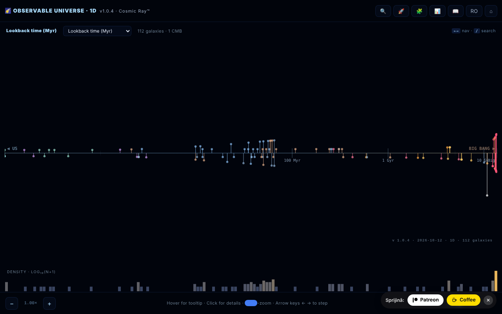

# Observable Universe 1D · The Cosmic Ray™

[English](README.md) · [Română](README.ro.md) · [Français](README.fr.md) · [Italiano](README.it.md) · [Español](README.es.md) · [Português](README.pt.md) · [Deutsch](README.de.md) · **Magyar**

**Verzió:** 1.2.0 · **Utolsó frissítés:** 2026-10-19

A megfigyelhető univerzum 1D-s térképe: 112 galaxis egyetlen sugárirányú tengelyre vetítve.

**Online alkalmazás:** https://chiuta.github.io/Universul-Observabil-1D/

## Mi ez

Egyetlen HTML-fájlból álló vizualizáció (v1.0.4), amely 112 galaxist helyez el egyetlen tengelyen a távolságuk szerint – az univerzum „legőszintébb” vetítése: szögtorzítás nélkül, de az azonos irányban lévő galaxisok ugyanabba a pontba esnek, egymásra vetülve. Ez az 1D változat, a 2D és 3D verziók társa. Az adatok a Planck 2018 ΛCDM kozmológiáját használják (H₀ = 67,4 km/s/Mpc); az alkalmazás „oktató jellegűnek” írja le magát, egyes szövegekben ironikus hangnemmel (nem tudományos publikáció); az értékek kerekítettek vagy hozzávetőlegesek, a Köszönetnyilvánításban szereplő források szerint. A felület kétnyelvű, román és angol (az oldal angolul indul).

## Funkciók

- Négy tengelymód: visszatekintési idő (lookback time), együttmozgó távolság, vöröseltolódás (z) és skálafaktor (a = 1/(1+z)).
- A galaxissűrűség logaritmikus hisztogramja.
- Nagyítás a tengelyen, szúrópróba-súgó (tooltip) lebegtetéskor, részletek panel egy galaxisra kattintva.
- **Adattábla** (📊 vagy a `D` billentyű): mind a 112 galaxis távolsággal, z-vel, lookback és együttmozgó értékkel, az aktuális H₀-val számolva; rendezhető oszlopok, szűrés név/típus szerint, CSV-export (`observable-universe-1d-h0-<H₀>.csv`). Egyben a térkép akadálymentes alternatívája (képernyőolvasók, billentyűzetes navigáció).
- Galaxiskeresés (🔍), vezetett túra (🚀), 10 kérdéses kozmikus kvíz pontszámmal (🧩), útmutató az Intro, Navigation, Axis Modes, Why 1D?, Terms, Limits, Changelog, Credits szakaszokkal (📖).
- RO / EN gomb a nyelvhez és ⌂ a nézet visszaállításához.
- A „SHARE” állandó hivatkozást hoz létre a nézet állapotával az URL töredékében (`#s=`); a „COPY” a szöveget a vágólapra másolja.
- Az oldalon deklarált hozzáférhetőség: tiszteletben tartja a `prefers-reduced-motion` beállítást, színtévesztő mód, billentyűzetes navigáció.

## Használati útmutató

1. Nyisd meg az oldalt; válaszd ki a tengelymódot a térkép fejlécében (lookback time, comoving distance, redshift, scale factor) — az `M` billentyű sorban végigléptet rajtuk.
2. Navigálás: egérgörgő vagy `+` / `-` a nagyításhoz, bal/jobb nyíl a galaxisok közti lépkedéshez, kattintás egy galaxisra a részletekért.
3. Keresés: nyomd meg a 🔍 gombot, a `/` billentyűt vagy a `Ctrl/Cmd+K` kombinációt; a fel/le nyilak választják ki az eredményt, az `Enter` megerősíti.
4. A `G` (útmutató), `T` (túra), `Q` (kvíz), `D` (adattábla), `L` (nyelv), `Esc` (panelek bezárása) billentyűk.
5. Egy galaxis paneljén nyomd meg a „SHARE” gombot hivatkozáshoz, vagy a „COPY” gombot szöveghez.
6. A ⌂ gomb visszaállítja a nézetet.

## Adatvédelem és hálózat

- Helyi: a beállítások a `localStorage`-ban tárolódnak (kulcs: `uv1d_prefs_v1`). A megosztási hivatkozás az állapotot csak az URL-ben tárolja.
- Hálózat: nem találtam `fetch` hívást, sem külső szkriptet vagy betűtípust; a galaxisok adatai a fájlban vannak. A támogatói és köszönetnyilvánítási hivatkozások (alexio.tf, Buy Me a Coffee) csak kattintásra nyílnak meg.
- Az útmutatóban a köszönetnyilvánítási szakasz adatforrásként a következőket említi: Planck 2018, NASA/IPAC NED, SIMBAD, JWST/JADES és Naidu et al. 2025. Futásidőben nem kérdezi le őket.

## Helyi futtatás / offline

Töltsd le az `index.html` fájlt, és nyisd meg böngészőben; internet nélkül is működik.

## Licenc

MIT — lásd a LICENSE fájlt

## Előzmények / Changelog

- 1.2.0 — 2026-10-19: „🗺️ 2D TÉRKÉP ↗” gomb a galaxis paneljén (ugyanaz a galaxis, az aktuális nyelven); a `#s=` permalink elfogadja a `gn` őrt.

- 1.1.0 — 2026-10-14: adatmentés és adatcímkézés (fff-kit).

- 1.0.4 — 2026-10-12: a verzió és az utolsó frissítés dátuma megjelenik az alkalmazásban.

v1.0.3 (2026. október 11.):
- Javítva: az `Esc` nem zárta be a kvízt (most bezárja; a kvíz billentyűzetről is játszható: `1`–`4`, Tab + Enter, a fókusz helyesen mozog); az adattábla és a részletek panel a csúszka mozgatása után a régi H₀-t tartotta meg (most azonnal frissül); RO módban a részletek panel az angol leírást is megjelenítette (most csak egy nyelv, RO tartalékkal az EN szöveg nélküli bejegyzésekhez); a „CMB · kozmológiai horizont” lefordítva.
- A katalógus távolságai összhangba hozva a z-vel, ugyanazzal a módszerrel, mint a v1.0.2-ben: IC 4296 (130 → ≈ 180 millió fényév), 3C 48 (5 200 → ≈ 4 150 millió fényév), Abell 370 (5 900 → ≈ 4 200 millió fényév), CL 0024+1654 (5 500 → ≈ 4 400 millió fényév). Más, kisebb eltérésű bejegyzések (pl. 3C 273) a katalógus értékein maradnak.
- A CSP hash újraszámolva; axe-core = 0 szabálysértés 1280 és 360 px-en.

v1.0.2 (2026. október 11.):
- Új: rendezhető/szűrhető adattábla CSV-exporttal (lásd a „Funkciók” részt).
- A katalógus távolságai összhangba hozva a közzétett vöröseltolódással négy ellentmondásos értékű bejegyzésnél: NGC 1132 (z = 0,0232: 1 020 → ≈ 330 millió fényév), Perseus / IC 310 (z = 0,0189: 780 → ≈ 270 millió fényév), Abell 1689 (z = 0,183: 7 200 → ≈ 2 330 millió fényév), SDSS J1004+4112 (z = 1,734: 7 000 → ≈ 10 050 millió fényév). Az értékek az alkalmazás ΛCDM kozmológiájában (H₀ = 67,4) a z-hez tartozó visszatekintési idők; a z-értékeket 2026. 10. 11-én megerősítettük (Wikipedia az NGC 1132 és az Abell 1689 esetében, Inada és mtsai 2003 az SDSS J1004+4112 esetében). Más bejegyzések (pl. Abell 370, 3C 48) távolsága 20–40%-kal tér el a z-nél vett lookbacktől, de a lookback és az együttmozgó távolság között marad, ezért nem módosítottuk őket.
- CSP: a szkript mostantól hash-sel engedélyezett (`script-src 'sha256-…'`), `'unsafe-inline'` nélkül; az alkalmazásban nincsenek beágyazott eseménykezelők.

v1.0.1 (2026. október 11.):
- Helyes származtatott értékek a közeli galaxisokra (d < 100 millió fényév): az Androméda most lookback ≈ 2,5 millió év és együttmozgó ≈ 2,5 millió fényév értéket mutat (korábban 14 millió év / 15 millió fényév, z-ből származtatva); z = −0,001 (kékeltolódás), nem +0,001. A tengelyen a pozíciók ugyanezeket az értékeket használják.
- A típuscímke románul: „Spirală galaxie” a „SPIRALĂ GALAXY” helyett.
- A tengelyfeliratoknak körvonaluk van; a fejléc és az adománywidget már nem takarja el a vezérlőket 360 px-en. axe-core = 0 szabálysértés (a `region` is).
- A vöröseltolódási rekordok továbbra is a „katalógus dátuma (2026. május)” szerintiek; a 2026. 10. 11-i webes keresés nem talált a MoM-z14-nél (z = 14,44) újabb spektroszkópiai rekordot, de a katalógust nem ellenőriztük újra rendszeresen.

## Szerző

Alexio — Alexandru-Ionuț Chiuță, kapcsolat: alexio@trom.tf. Az alkalmazás a köszönetnyilvánításában a Centrul StrING-et is említi.

## Audit

Audit: 2026-10-10; 2. kör: 2026-10-11 — a hivatkozásból eltávolítva a fiktív értékű „DOI” mező (nincs valódi DOI); átfogalmazva a „szatirikus és oktató” / „minden adat helyes” megjegyzés (RO+EN útmutató és README). A viewport és a kontraszt az 1. körben javítva. 3. kör (2026-10-11): az idővel avuló állítások („abszolút/aktuális rekord”, „ÚJ”, „legközelebbi/legtávolabbi”) átfogalmazva „a katalógus dátuma (2026. május)” szerint, a forrással (Naidu és mtsai 2025 a MoM-z14-hez; arXiv 2603.15841 az EGS-z11-R0-hoz). A rekordok e dátum után túlszárnyalhatók.

## Angol nyelvű összefoglaló

A megfigyelhető univerzum egyfájlos 1D-s térképe: 112 galaxis egyetlen sugárirányú tengelyen, átkapcsolható visszatekintési idő, együttmozgó távolság, vöröseltolódás és skálafaktor között, logaritmikus sűrűséghisztogrammal, kereséssel, vezetett túrával, 10 kérdéses kvízzel, kétnyelvű RO/EN felülettel és megosztható permalinkekkel. A beállítások a localStorage-ban tárolódnak; a kódban nem találtunk külső kéréseket. MIT licenc.
