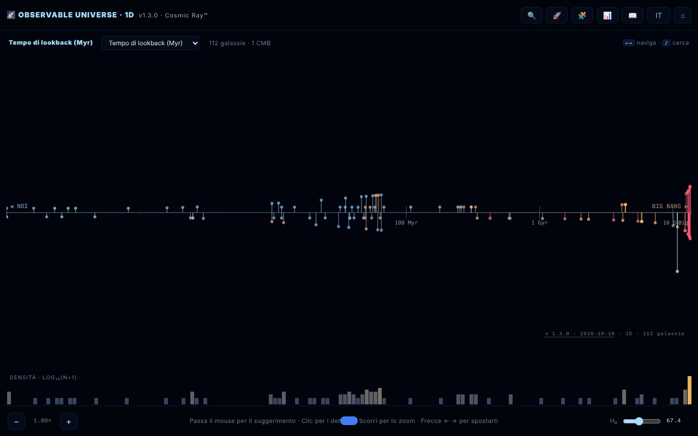

# Observable Universe 1D · The Cosmic Ray™

[English](README.md) · [Română](README.ro.md) · [Français](README.fr.md) · **Italiano** · [Español](README.es.md) · [Português](README.pt.md) · [Deutsch](README.de.md) · [Magyar](README.hu.md)

**Versione:** 1.3.1 · **Ultimo aggiornamento:** 2026-10-19

Lingue dell'interfaccia: **Română, English, Français, Italiano, Español, Português (PT), Deutsch, Magyar**

Mappa 1D dell'universo osservabile: 112 galassie proiettate su un unico asse radiale.

**App online:** https://chiuta.github.io/Universul-Observabil-1D/

## Che cos'è

Una visualizzazione in un unico file HTML (v1.0.4) che dispone 112 galassie su un solo asse in funzione della distanza, la proiezione «più onesta» dell'universo: senza distorsioni angolari, ma con le galassie che si trovano nella stessa direzione sovrapposte nello stesso punto. È la versione 1D, compagna delle versioni 2D e 3D. I dati usano la cosmologia ΛCDM di Planck 2018 (H₀ = 67,4 km/s/Mpc); l'applicazione si descrive come «educativa», con un tono ironico in alcuni testi (non è una pubblicazione scientifica); i valori sono arrotondati o approssimativi, secondo le fonti indicate nei Crediti. L'interfaccia ha 8 lingue (RO, EN, FR, IT, ES, PT, DE, HU); la pagina parte nella lingua del browser, altrimenti in inglese.

## Funzionalità

- Quattro modalità dell'asse: tempo di retrospezione (lookback time), distanza comovente, redshift (z) e fattore di scala (a = 1/(1+z)).
- Istogramma logaritmico della densità delle galassie.
- Zoom sull'asse, tooltip al passaggio del mouse, pannello di dettagli al clic su una galassia.
- **Tabella dei dati** (📊 o tasto `D`): tutte le 112 galassie con distanza, z, lookback e distanza comovente calcolati con l'H₀ corrente; colonne ordinabili, filtro per nome/tipo, esportazione CSV (`observable-universe-1d-h0-<H₀>.csv`). È anche l'alternativa accessibile alla mappa (lettori di schermo, navigazione da tastiera).
- Ricerca di galassie (🔍), tour guidato (🚀), quiz cosmico di 10 domande con punteggio (🧩), guida con le sezioni Intro, Navigation, Axis Modes, Why 1D?, Terms, Limits, Changelog, Credits (📖).
- Selettore di lingua e ⌂ per reimpostare la vista.
- «SHARE» genera un link permanente con lo stato della vista nel frammento dell'URL (`#s=`); «COPY» copia il testo negli appunti.
- Accessibilità dichiarata nella pagina: rispetta `prefers-reduced-motion`, modalità per il daltonismo, navigazione da tastiera.

## Guida all'uso

1. Apri la pagina; scegli la modalità dell'asse dall'intestazione della mappa (lookback time, comoving distance, redshift, scale factor) — il tasto `M` le scorre una dopo l'altra.
2. Naviga: rotellina del mouse o `+` / `-` per lo zoom, frecce sinistra/destra per passare da una galassia all'altra, clic su una galassia per i dettagli.
3. Ricerca: premi 🔍, il tasto `/` o `Ctrl/Cmd+K`; le frecce su/giù scelgono il risultato, `Invio` lo seleziona.
4. I tasti `G` (guida), `T` (tour), `Q` (quiz), `D` (tabella dei dati), `L` (lingua), `Esc` (chiude i pannelli).
5. Nel pannello di una galassia premi «SHARE» per il link o «COPY» per il testo.
6. Il pulsante ⌂ reimposta la vista.

## Privacy e rete

- Locale: le preferenze sono conservate in `localStorage` (chiave `uv1d_prefs_v1`). Il link di condivisione memorizza lo stato solo nell'URL.
- Rete: non ho trovato chiamate `fetch` né script o font esterni; i dati delle galassie sono inclusi nel file. I link di sostegno e di credito (alexio.tf, Buy Me a Coffee) si aprono solo se li clicchi.
- Nella guida, la sezione dei crediti cita come fonti dei dati: Planck 2018, NASA/IPAC NED, SIMBAD, JWST/JADES e Naidu et al. 2025. Non vengono interrogate durante l'esecuzione.

## Esecuzione locale / offline

Scarica `index.html` e aprilo in un browser; funziona senza internet.

## Licenza

MIT — vedi il file LICENSE

## Cronologia / Changelog

- 1.2.0 — 2026-10-19: pulsante «🗺️ MAPPA 2D ↗» nel pannello della galassia (stessa galassia, lingua corrente); il permalink `#s=` accetta la guardia `gn`.

- 1.1.0 — 2026-10-14: backup ed etichettatura dei dati (fff-kit).

- 1.0.4 — 2026-10-12: la versione e la data dell'ultimo aggiornamento sono mostrate nell'app.

v1.0.3 (11 ottobre 2026):
- Corretto: `Esc` non chiudeva il quiz (ora lo chiude; il quiz si può giocare anche da tastiera: `1`–`4`, Tab + Invio, focus spostato correttamente); la tabella dei dati e il pannello dei dettagli mantenevano il vecchio H₀ dopo lo spostamento del cursore (ora si aggiornano subito); in modalità RO il pannello dei dettagli mostrava anche la descrizione in inglese (ora una sola lingua, con ripiego RO per le voci senza testo EN); «CMB · orizzonte cosmologico» tradotto.
- Distanze del catalogo allineate a z, stesso metodo della v1.0.2: IC 4296 (130 → ≈ 180 Mal), 3C 48 (5 200 → ≈ 4 150 Mal), Abell 370 (5 900 → ≈ 4 200 Mal), CL 0024+1654 (5 500 → ≈ 4 400 Mal). Altre voci con scostamenti minori (ad es. 3C 273) restano ai valori del catalogo.
- Hash CSP ricalcolato; axe-core = 0 violazioni a 1280 e 360 px.

v1.0.2 (11 ottobre 2026):
- Novità: tabella dei dati ordinabile/filtrabile con esportazione CSV (vedi «Funzionalità»).
- Distanze del catalogo allineate al redshift pubblicato per quattro voci con valori incoerenti: NGC 1132 (z = 0,0232: 1 020 → ≈ 330 Mal), Perseus / IC 310 (z = 0,0189: 780 → ≈ 270 Mal), Abell 1689 (z = 0,183: 7 200 → ≈ 2 330 Mal), SDSS J1004+4112 (z = 1,734: 7 000 → ≈ 10 050 Mal). I valori sono il tempo di retrospezione a z nella cosmologia ΛCDM dell'applicazione (H₀ = 67,4); i z sono stati confermati l'11.10.2026 (Wikipedia per NGC 1132 e Abell 1689, Inada et al. 2003 per SDSS J1004+4112). Altre voci (ad es. Abell 370, 3C 48) hanno distanze che differiscono dal lookback a z del 20–40%, ma restano comprese tra il lookback e la distanza comovente, perciò non sono state modificate.
- CSP: lo script è ora consentito tramite hash (`script-src 'sha256-…'`), senza `'unsafe-inline'`; l'applicazione non ha gestori inline.

v1.0.1 (11 ottobre 2026):
- Valori derivati corretti per le galassie vicine (d < 100 Mal): Andromeda mostra ora lookback ≈ 2,5 Ma e distanza comovente ≈ 2,5 Mal (prima 14 Ma / 15 Mal, derivati da z); z = −0,001 (spostamento verso il blu), non +0,001. Le posizioni sull'asse usano gli stessi valori.
- Etichetta del tipo in rumeno: «Spirală galaxie» invece di «SPIRALĂ GALAXY».
- Le etichette dell'asse hanno un contorno; l'intestazione e il widget delle donazioni non coprono più i controlli a 360 px. axe-core = 0 violazioni (incluso `region`).
- I record di redshift restano quelli «alla data del catalogo (maggio 2026)»; una ricerca sul web dell'11.10.2026 non ha trovato un record spettroscopico più recente di MoM-z14 (z = 14,44), ma il catalogo non è stato ricontrollato sistematicamente.

## Autore

Alexio — Alexandru-Ionuț Chiuță, contatto: alexio@trom.tf. L'applicazione cita anche il Centrul StrING nei suoi crediti.

## Audit

Audit: 2026-10-10; turno 2: 2026-10-11 — rimosso dalla citazione il campo «DOI» con valore fittizio (non esiste un DOI reale); riformulata l'indicazione «satirico ed educativo» / «tutti i dati sono corretti» (guida RO+EN e README). Viewport e contrasto corretti nel turno 1. Turno 3 (2026-10-11): le affermazioni deperibili («record assoluto/attuale», «NUOVO», «la più vicina/lontana») riformulate come «alla data del catalogo (maggio 2026)», con la fonte (Naidu et al. 2025 per MoM-z14; arXiv 2603.15841 per EGS-z11-R0). I record possono essere superati dopo questa data.

## Riepilogo
Una mappa 1D dell'universo osservabile a file singolo: 112 galassie su un unico asse radiale, commutabile tra tempo di retrospezione, distanza comovente, redshift e fattore di scala, con istogramma logaritmico della densità, ricerca, tour guidato, quiz di 10 domande, interfaccia in 8 lingue e permalink condivisibili. Le preferenze sono conservate in localStorage; nel codice non sono state trovate richieste esterne. Licenza MIT.
