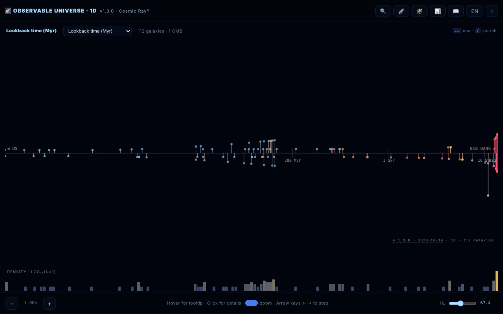

# Observable Universe 1D · The Cosmic Ray™

**English** · [Română](README.ro.md) · [Français](README.fr.md) · [Italiano](README.it.md) · [Español](README.es.md) · [Português](README.pt.md) · [Deutsch](README.de.md) · [Magyar](README.hu.md)

**Version:** 1.3.3 · **Last updated:** 2026-10-22

Interface languages: **Română, English, Français, Italiano, Español, Português (PT), Deutsch, Magyar**

A 1D map of the observable universe: 112 galaxies projected onto a single radial axis.

**Live app:** https://chiuta.github.io/Universul-Observabil-1D/

## What it is

A visualization in a single HTML file (v1.3.1) that places 112 galaxies on one axis according to distance, "the most honest" projection of the universe: no angular distortion, but with galaxies lying in the same direction superimposed at the same point. It is the 1D version, a companion to the 2D and 3D versions. The data use the Planck 2018 ΛCDM cosmology (H₀ = 67.4 km/s/Mpc); the application describes itself as "educational", with an ironic tone in some texts (it is not a scientific publication); values are rounded or approximate, according to the sources in the Credits. The interface has 8 languages (RO, EN, FR, IT, ES, PT, DE, HU); the page starts in the browser language, otherwise in English.

**Languages:** all the text (guide, guided tour with its 8 stops, quiz with options and explanations, descriptions of the 112 galaxies) is available in the 8 languages; only proper names, cited sources and export formats are left as they are. The translations are automatic; a native review is recommended, especially for astronomical terminology.

## Features

- Four axis modes: lookback time, comoving distance, redshift (z) and scale factor (a = 1/(1+z)).
- Logarithmic histogram of galaxy density.
- Zoom on the axis, hover tooltip, details panel on clicking a galaxy.
- **Data table** (📊 or the `D` key): all 112 galaxies with distance, z, lookback and comoving computed with the current H₀; sortable columns, filter by name/type, CSV export (`observable-universe-1d-h0-<H₀>.csv`). It is also the accessible alternative to the map (screen readers, keyboard navigation).
- Galaxy search (🔍), guided tour (🚀), 10-question cosmic quiz with a score (🧩), guide with the sections Intro, Navigation, Axis Modes, Why 1D?, Terms, Limits, Changelog, Credits (📖).
- Language selector and ⌂ for resetting the view.
- "SHARE" generates a permanent link with the view state in the URL fragment (`#s=`); "COPY" copies the text to the clipboard.
- Accessibility declared in the page: respects `prefers-reduced-motion`, colour-blind mode, keyboard navigation.

## User guide

1. Open the page; choose the axis mode from the map header (lookback time, comoving distance, redshift, scale factor) — the `M` key cycles through them.
2. Navigate: mouse wheel or `+` / `-` to zoom, left/right arrows to move from one galaxy to another, click a galaxy for details.
3. Search: press 🔍, the `/` key or `Ctrl/Cmd+K`; the up/down arrows pick the result, `Enter` selects it.
4. The keys `G` (guide), `T` (tour), `Q` (quiz), `D` (data table), `L` (language), `Esc` (close panels).
5. In a galaxy's panel press "SHARE" for a link or "COPY" for text.
6. The ⌂ button resets the view.

## Privacy and network

- Local: preferences are kept in `localStorage` (key `uv1d_prefs_v1`). The share link stores the state only in the URL.
- Network: I found no `fetch` calls and no external scripts or fonts; the galaxy data is included in the file. The support and credit links (alexio.tf, Buy Me a Coffee) open only if you click them.
- In the guide, the credits section lists as data sources: Planck 2018, NASA/IPAC NED, SIMBAD, JWST/JADES and Naidu et al. 2025. They are not queried at runtime.

## Running locally / offline

Download `index.html` and open it in a browser; it works without internet.

## License

MIT — see the LICENSE file

## History / Changelog

- **1.3.3 — 2026-10-22:** the data-table filter field (placeholder and accessibility label) is now translated from the start, not only after opening the table.
- 1.3.2 — 2026-10-22: localized names of the galaxies and objects in all 8 languages (Milky Way, Pinwheel, Whirlpool, etc. no longer stay in Romanian); page title and meta descriptions follow the interface language.

- 1.3.1 — 2026-10-19: guide, guided tour, quiz (all 12 question types, options and explanations) and the 112 galaxy descriptions translated into fr, it, es, pt, de, hu; the statement that the long texts "remain in ro/en" was removed.
- 1.2.0 — 2026-10-19: "🗺️ 2D MAP ↗" button in the galaxy panel (same galaxy, current language); the `#s=` permalink accepts the `gn` guard.

- 1.1.0 — 2026-10-14: Backup and data labelling (fff-kit).

- 1.0.4 — 2026-10-12: the version and the last-updated date are shown in the app.

v1.0.3 (11 October 2026):
- Fixed: `Esc` did not close the quiz (now it does; the quiz can also be played from the keyboard: `1`–`4`, Tab + Enter, focus moved correctly); the data table and the details panel kept the old H₀ after moving the slider (now they update immediately); in RO mode the details panel also showed the description in English (now a single language, with an RO fallback for entries without EN text); "CMB · cosmological horizon" translated.
- Catalogue distances brought into line with z, same method as in v1.0.2: IC 4296 (130 → ≈ 180 Mly), 3C 48 (5,200 → ≈ 4,150 Mly), Abell 370 (5,900 → ≈ 4,200 Mly), CL 0024+1654 (5,500 → ≈ 4,400 Mly). Other entries with smaller deviations (e.g. 3C 273) remain at the catalogue values.
- CSP hash recalculated; axe-core = 0 violations at 1280 and 360 px.

v1.0.2 (11 October 2026):
- New: sortable/filterable data table with CSV export (see "Features").
- Catalogue distances brought into line with the published redshift for four entries with inconsistent values: NGC 1132 (z = 0.0232: 1,020 → ≈ 330 Mly), Perseus / IC 310 (z = 0.0189: 780 → ≈ 270 Mly), Abell 1689 (z = 0.183: 7,200 → ≈ 2,330 Mly), SDSS J1004+4112 (z = 1.734: 7,000 → ≈ 10,050 Mly). The values are the lookback time at z in the application's ΛCDM cosmology (H₀ = 67.4); the z values were confirmed on 11.10.2026 (Wikipedia for NGC 1132 and Abell 1689, Inada et al. 2003 for SDSS J1004+4112). Other entries (e.g. Abell 370, 3C 48) have distances that differ from the lookback at z by 20–40%, but remain between the lookback and the comoving distance, so they were not changed.
- CSP: the script is now allowed by hash (`script-src 'sha256-…'`), without `'unsafe-inline'`; the application has no inline handlers.

v1.0.1 (11 October 2026):
- Correct derived values for nearby galaxies (d < 100 Mly): Andromeda now shows lookback ≈ 2.5 Myr and comoving ≈ 2.5 Mly (previously 14 Myr / 15 Mly, derived from z); z = −0.001 (blueshift), not +0.001. Positions on the axis use the same values.
- Type label in Romanian: "Spirală galaxie" instead of "SPIRALĂ GALAXY".
- Axis labels have an outline; the header and the donations widget no longer cover the controls at 360 px. axe-core = 0 violations (including `region`).
- The redshift records remain those "as of the catalogue date (May 2026)"; a web search on 11.10.2026 found no spectroscopic record newer than MoM-z14 (z = 14.44), but the catalogue was not systematically rechecked.

## Author

Alexio — Alexandru-Ionuț Chiuță, contact: alexio@trom.tf. The application also names Centrul StrING in its credits.

## Audit

Audit: 2026-10-10; round 2: 2026-10-11 — removed from the citation the "DOI" field with a fictitious value (there is no real DOI); reworded the "satirical and educational" / "all data are correct" statement (RO+EN guide and README). Viewport and contrast fixed in round 1. Round 3 (2026-10-11): perishable claims ("absolute/current record", "NEW", "nearest/farthest") reworded as "as of the catalogue date (May 2026)", with the source (Naidu et al. 2025 for MoM-z14; arXiv 2603.15841 for EGS-z11-R0). Records may be surpassed after this date.

## English summary

A single-file 1D map of the observable universe: 112 galaxies on one radial axis, switchable between lookback time, comoving distance, redshift and scale factor, with a log density histogram, search, guided tour, 10-question quiz, 8-language UI and shareable permalinks. Preferences are kept in localStorage; no external requests were found in the code. MIT licence.
