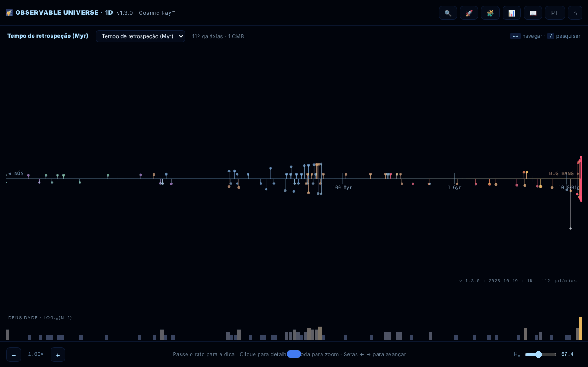

# Observable Universe 1D · The Cosmic Ray™

[English](README.md) · [Română](README.ro.md) · [Français](README.fr.md) · [Italiano](README.it.md) · [Español](README.es.md) · **Português** · [Deutsch](README.de.md) · [Magyar](README.hu.md)

**Versão:** 1.3.3 · **Última atualização:** 2026-10-22

Idiomas da interface: **Română, English, Français, Italiano, Español, Português (PT), Deutsch, Magyar**

Mapa 1D do universo observável: 112 galáxias projetadas num único eixo radial.

**Aplicação online:** https://chiuta.github.io/Universul-Observabil-1D/

## O que é

Uma visualização num único ficheiro HTML (v1.3.1) que coloca 112 galáxias num só eixo em função da distância, a projeção «mais honesta» do universo: sem distorções angulares, mas com as galáxias situadas na mesma direção sobrepostas no mesmo ponto. É a versão 1D, companheira das versões 2D e 3D. Os dados usam a cosmologia ΛCDM de Planck 2018 (H₀ = 67,4 km/s/Mpc); a aplicação descreve-se como «educativa», com um tom irónico em alguns textos (não é uma publicação científica); os valores são arredondados ou aproximados, de acordo com as fontes dos Créditos. A interface tem 8 idiomas (RO, EN, FR, IT, ES, PT, DE, HU); a página arranca no idioma do navegador e, caso contrário, em inglês.

**Idiomas:** todo o texto (guia, visita guiada com as suas 8 paragens, questionário com opções e explicações, descrições das 112 galáxias) está disponível nos 8 idiomas; só permanecem inalterados os nomes próprios, as fontes citadas e os formatos de exportação. As traduções são automáticas; recomenda-se revisão nativa, sobretudo da terminologia astronómica.

## Funcionalidades

- Quatro modos de eixo: tempo de retrospeção (lookback time), distância comóvel, desvio para o vermelho (z) e fator de escala (a = 1/(1+z)).
- Histograma logarítmico da densidade de galáxias.
- Zoom no eixo, dica ao passar o rato, painel de detalhes ao clicar numa galáxia.
- **Tabela de dados** (📊 ou tecla `D`): as 112 galáxias com distância, z, lookback e distância comóvel calculados com o H₀ atual; colunas ordenáveis, filtro por nome/tipo, exportação CSV (`observable-universe-1d-h0-<H₀>.csv`). É também a alternativa acessível ao mapa (leitores de ecrã, navegação por teclado).
- Pesquisa de galáxias (🔍), visita guiada (🚀), questionário cósmico de 10 perguntas com pontuação (🧩), guia com as secções Intro, Navigation, Axis Modes, Why 1D?, Terms, Limits, Changelog, Credits (📖).
- Seletor de idioma e ⌂ para repor a vista.
- «SHARE» gera uma ligação permanente com o estado da vista no fragmento do URL (`#s=`); «COPY» copia o texto para a área de transferência.
- Acessibilidade declarada na página: respeita `prefers-reduced-motion`, modo para daltonismo, navegação por teclado.

## Manual de utilização

1. Abra a página; escolha o modo de eixo no cabeçalho do mapa (lookback time, comoving distance, redshift, scale factor) — a tecla `M` percorre-os um a um.
2. Navegue: roda do rato ou `+` / `-` para o zoom, setas esquerda/direita para passar de uma galáxia a outra, clique numa galáxia para ver os detalhes.
3. Pesquisa: prima 🔍, a tecla `/` ou `Ctrl/Cmd+K`; as setas cima/baixo escolhem o resultado, `Enter` seleciona-o.
4. As teclas `G` (guia), `T` (visita), `Q` (questionário), `D` (tabela de dados), `L` (idioma), `Esc` (fecha os painéis).
5. No painel de uma galáxia, prima «SHARE» para a ligação ou «COPY» para o texto.
6. O botão ⌂ repõe a vista.

## Privacidade e rede

- Local: as preferências são guardadas em `localStorage` (chave `uv1d_prefs_v1`). A ligação de partilha armazena o estado apenas no URL.
- Rede: não encontrei chamadas `fetch` nem scripts ou tipos de letra externos; os dados das galáxias estão incluídos no ficheiro. As ligações de apoio e de crédito (alexio.tf, Buy Me a Coffee) só se abrem se clicar nelas.
- No guia, a secção de créditos menciona como fontes de dados: Planck 2018, NASA/IPAC NED, SIMBAD, JWST/JADES e Naidu et al. 2025. Não são consultadas durante a execução.

## Execução local / offline

Transfira `index.html` e abra-o num navegador; funciona sem internet.

## Licença

MIT — veja o ficheiro LICENSE

## Histórico / Changelog

- **1.3.3 — 2026-10-22:** o campo de filtro da tabela de dados (texto de exemplo e etiqueta de acessibilidade) é traduzido desde o início, e não só depois de abrir a tabela.
- 1.3.2 — 2026-10-22: nomes de galáxias e objetos localizados nos 8 idiomas (Via Láctea, Catavento, Redemoinho, etc. deixam de ficar em romeno); o título da página e as metadescrições acompanham o idioma da interface.

- 1.3.1 — 2026-10-19: o guia, a visita guiada, o questionário (os 12 tipos de perguntas, opções e explicações) e as 112 descrições de galáxias estão traduzidos para fr, it, es, pt, de, hu; foi removida a afirmação de que os textos longos «permanecem em ro/en».
- 1.2.0 — 2026-10-19: botão «🗺️ MAPA 2D ↗» no painel da galáxia (a mesma galáxia, idioma atual); o permalink `#s=` aceita a guarda `gn`.

- 1.1.0 — 2026-10-14: cópia de segurança e etiquetagem de dados (fff-kit).

- 1.0.4 — 2026-10-12: a versão e a data da última atualização são apresentadas na aplicação.

v1.0.3 (11 de outubro de 2026):
- Corrigido: `Esc` não fechava o questionário (agora fecha; o questionário também pode ser jogado com o teclado: `1`–`4`, Tab + Enter, foco movido corretamente); a tabela de dados e o painel de detalhes mantinham o H₀ antigo depois de mover o cursor (agora atualizam-se de imediato); no modo RO o painel de detalhes mostrava também a descrição em inglês (agora uma única língua, com alternativa RO para as entradas sem texto EN); «CMB · horizonte cosmológico» traduzido.
- Distâncias do catálogo ajustadas a z, mesmo método da v1.0.2: IC 4296 (130 → ≈ 180 Mal), 3C 48 (5 200 → ≈ 4 150 Mal), Abell 370 (5 900 → ≈ 4 200 Mal), CL 0024+1654 (5 500 → ≈ 4 400 Mal). Outras entradas com desvios menores (p. ex. 3C 273) permanecem nos valores do catálogo.
- Hash CSP recalculado; axe-core = 0 violações a 1280 e 360 px.

v1.0.2 (11 de outubro de 2026):
- Novo: tabela de dados ordenável/filtrável com exportação CSV (ver «Funcionalidades»).
- Distâncias do catálogo ajustadas ao desvio para o vermelho publicado em quatro entradas com valores incoerentes: NGC 1132 (z = 0,0232: 1 020 → ≈ 330 Mal), Perseus / IC 310 (z = 0,0189: 780 → ≈ 270 Mal), Abell 1689 (z = 0,183: 7 200 → ≈ 2 330 Mal), SDSS J1004+4112 (z = 1,734: 7 000 → ≈ 10 050 Mal). Os valores são o tempo de retrospeção a z na cosmologia ΛCDM da aplicação (H₀ = 67,4); os z foram confirmados em 11.10.2026 (Wikipédia para NGC 1132 e Abell 1689, Inada et al. 2003 para SDSS J1004+4112). Outras entradas (p. ex. Abell 370, 3C 48) têm distâncias que diferem do lookback a z em 20–40 %, mas ficam entre o lookback e a distância comóvel, pelo que não foram alteradas.
- CSP: o script é agora permitido por hash (`script-src 'sha256-…'`), sem `'unsafe-inline'`; a aplicação não tem manipuladores em linha.

v1.0.1 (11 de outubro de 2026):
- Valores derivados corretos para galáxias próximas (d < 100 Mal): Andrómeda mostra agora lookback ≈ 2,5 Man e distância comóvel ≈ 2,5 Mal (antes 14 Man / 15 Mal, derivados de z); z = −0,001 (desvio para o azul), e não +0,001. As posições no eixo usam os mesmos valores.
- Etiqueta de tipo em romeno: «Spirală galaxie» em vez de «SPIRALĂ GALAXY».
- As etiquetas do eixo têm contorno; o cabeçalho e o widget de donativos já não tapam os controlos a 360 px. axe-core = 0 violações (incluindo `region`).
- Os recordes de desvio para o vermelho continuam a ser os «à data do catálogo (maio de 2026)»; uma pesquisa na web de 11.10.2026 não encontrou nenhum recorde espectroscópico mais recente do que MoM-z14 (z = 14,44), mas o catálogo não foi reverificado sistematicamente.

## Autor

Alexio — Alexandru-Ionuț Chiuță, contacto: alexio@trom.tf. A aplicação refere também o Centrul StrING nos seus créditos.

## Auditoria

Auditoria: 2026-10-10; ronda 2: 2026-10-11 — removido da citação o campo «DOI» com valor fictício (não existe um DOI real); reformulada a menção «satírico e educativo» / «todos os dados estão corretos» (guia RO+EN e README). Viewport e contraste corrigidos na ronda 1. Ronda 3 (2026-10-11): as afirmações perecíveis («recorde absoluto/atual», «NOVO», «a mais próxima/distante») reformuladas como «à data do catálogo (maio de 2026)», com a fonte (Naidu et al. 2025 para MoM-z14; arXiv 2603.15841 para EGS-z11-R0). Os recordes podem ser ultrapassados após esta data.

## Resumo
Um mapa 1D do universo observável num único ficheiro: 112 galáxias num só eixo radial, comutável entre tempo de retrospeção, distância comóvel, desvio para o vermelho e fator de escala, com histograma logarítmico de densidade, pesquisa, visita guiada, questionário de 10 perguntas, interface em 8 idiomas e permalinks partilháveis. As preferências são guardadas em localStorage; não foram encontrados pedidos externos no código. Licença MIT.
