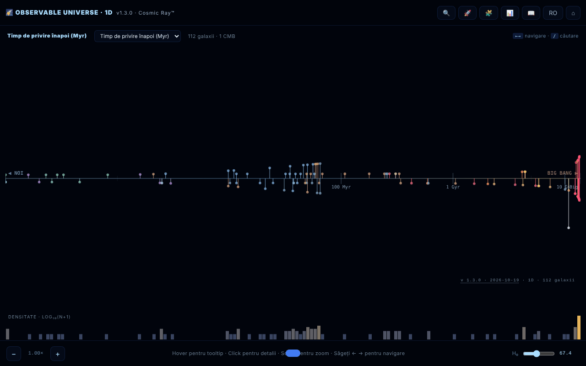

# Observable Universe 1D · The Cosmic Ray™

[English](README.md) · **Română** · [Français](README.fr.md) · [Italiano](README.it.md) · [Español](README.es.md) · [Português](README.pt.md) · [Deutsch](README.de.md) · [Magyar](README.hu.md)

**Versiune:** 2.1.0 · **Ultima actualizare:** 2026-10-27

**Stare:** stabil · **Offline:** complet

Limbile interfeței: **Română, English, Français, Italiano, Español, Português (PT), Deutsch, Magyar**

Harta 1D a universului observabil: 112 galaxii proiectate pe o singură axă radială.

**Live:** https://chiuta.github.io/Universul-Observabil-1D/

## Ce este

O vizualizare dintr-un singur fișier HTML (v1.3.1) care așază 112 galaxii pe o singură axă, în funcție de distanță, „cel mai onest" proiect al universului: fără distorsiuni unghiulare, dar cu galaxiile aflate pe aceeași direcție suprapuse în același punct. Este varianta 1D, însoțitoare a versiunilor 2D și 3D. Datele folosesc cosmologia ΛCDM Planck 2018 (H₀ = 67,4 km/s/Mpc); aplicația se descrie ca „educațională”, cu un ton ironic în unele texte (nu este o publicație științifică); valorile sunt rotunjite sau aproximative, conform surselor din Credite. Interfața are 8 limbi (RO, EN, FR, IT, ES, PT, DE, HU); pagina pornește în limba browserului, altfel în engleză.

**Limbi:** tot textul (ghid, tur ghidat cu cele 8 opriri, quiz cu variante și explicații, descrierile celor 112 galaxii) este disponibil în cele 8 limbi; rămân neschimbate doar numele proprii, sursele citate și formatele de export. Traducerile sunt automate; se recomandă revizie nativă, mai ales pentru terminologia astronomică.

## Funcții

- Patru moduri de axă: timp de privire înapoi (lookback time), distanță comobilă, redshift (z) și factor de scară (a = 1/(1+z)).
- Histogramă logaritmică a densității galaxiilor.
- Zoom pe axă, tooltip la hover, panou de detalii la click pe o galaxie.
- **Tabel de date** (📊 sau tasta `D`): toate cele 112 de galaxii cu distanță, z, lookback și comoving calculate cu H₀ curent; coloane sortabile, filtru după nume/tip, export CSV (`observable-universe-1d-h0-<H₀>.csv`). Este și alternativa accesibilă la hartă (cititoare de ecran, navigare de la tastatură).
- **Călătoria luminii** (💡 sau tasta `J`, v2.0): un foton pornește pe axă. Fie de la o galaxie spre noi, cu cronologia drumului (vârsta Universului la emisie, timp de călătorie, distanța proprie și comobilă, evenimente de pe Pământ petrecute între timp), fie de la noi, astăzi, spre viitor, până la orizontul cosmic de evenimente (≈16,5 Gly comobili în ΛCDM cu energie întunecată constantă). Butonul „💡 JOURNEY” din panoul galaxiei o deschide direct; tabelul de date are acum și linkuri „2D ↗”.
- Căutare de galaxii (🔍), tur ghidat (🚀), quiz cosmic de 10 întrebări cu scor (🧩), ghid cu secțiunile Intro, Navigation, Axis Modes, Why 1D?, Terms, Limits, Changelog, Credits (📖).
- Selector de limbă și ⌂ pentru resetarea vizualizării.
- „SHARE" generează un link permanent cu starea vizualizării în fragmentul URL (`#s=`); „COPY" copiază textul în clipboard.
- Accesibilitate declarată în pagină: respectă `prefers-reduced-motion`, mod pentru daltonism, navigare de la tastatură.

## Manual de utilizare

1. Deschide pagina; alege modul de axă din antetul hărții (lookback time, comoving distance, redshift, scale factor) — tasta `M` le parcurge pe rând.
2. Navighează: roata mouse-ului sau `+` / `-` pentru zoom, săgețile stânga/dreapta pentru a trece de la o galaxie la alta, click pe o galaxie pentru detalii.
3. Căutare: apasă 🔍, tasta `/` sau `Ctrl/Cmd+K`; săgețile sus/jos aleg rezultatul, `Enter` îl selectează.
4. Tastele `G` (ghid), `T` (tur), `Q` (quiz), `D` (tabel de date), `L` (limbă), `Esc` (închide panourile).
5. În panoul unei galaxii apasă „SHARE" pentru link sau „COPY" pentru text.
6. Butonul ⌂ resetează vizualizarea.

## Confidențialitate și rețea

- Local: preferințele se păstrează în `localStorage` (cheia `universul-observabil-1d.prefs`). Linkul de partajare stochează starea doar în URL.
- Rețea: nu am găsit apeluri `fetch`, scripturi sau fonturi externe; datele galaxiilor sunt incluse în fișier. Linkurile de susținere și de credit (alexio.tf, Buy Me a Coffee) se deschid doar dacă le apeși.
- În ghid, secțiunea de credite menționează ca surse de date: Planck 2018, NASA/IPAC NED, SIMBAD, JWST/JADES și Naidu et al. 2025. Nu sunt interogate în timpul rulării.

## Rulare locală / offline

Descarcă `index.html` și deschide-l în browser; funcționează fără internet.

## Licență

MIT — vezi fișierul LICENSE

## Mărimea cataloagelor în serie (2.0.1)

- **Numere.** Hub: 112 intrări (copie identică a catalogului 1D). 1D: 112. 2D: 112 (111 galaxii + orizontul CMB; unele texte spun 111). 3D: 118 („peste 115” în descrieri). Cifrele diferă pentru că cataloagele sunt separate, nu dintr-o eroare de numărare.
- **Neunificate.** 3D are catalogul propriu, într-o structură diferită (RA în ore, alte nume și grafii), așa că numele se potrivesc doar parțial cu 1D/2D. Unificarea într-un singur fișier comun nu s-a făcut: fiecare aplicație este un singur fișier offline, fără pas de build comun, iar îmbinarea ar schimba datele în trei aplicații fără cum să fie validată aici. Semnalat autorului.
- **Conflict cunoscut 1D ↔ 2D (necorectat, de verificat cu surse).** Cele două cataloage au aceleași 112 nume, dar 8 intrări au altă distanță (d = lookback, în Mly, 1D→2D): NGC 1132 330→1020, Perseus (BCG IC 310) 270→780, 3C 48 4150→5200, Abell 370 4200→5900, CL 0024+1654 4400→5500, SDSS J1004+4112 10050→7000, IC 4296 180→130, Abell 1689 2330→7200; iar semnul redshift-ului Andromedei (M31) este −0,001 în 1D și +0,001 în 2D.

## Recorduri JWST reverificate (27.10.2026)

- **MoM-z14:** z = 14,44, încă cea mai îndepărtată galaxie confirmată spectroscopic (Naidu et al., arXiv:2505.11263; publicat în Open Journal of Astrophysics, ian. 2026).
- **JADES-GS-z14-0:** NIRSpec z = 14,32 (+0,08/−0,20) (Carniani et al. 2024, Nature); ALMA [OIII] 88 µm z = 14,1793 ± 0,0007 (Schouws et al. 2025, arXiv:2409.20549), compatibil. Catalogul păstrează valoarea NIRSpec; valoarea ALMA este menționată în descriere.
- **PAN-z14-1:** z = 13,53 (+0,05/−0,06), JWST/NIRSpec (Donnan et al., arXiv:2601.11515, ian. 2026): a patra ca distanță, nu un record. Nu a fost adăugată în catalog (coordonatele nu au fost verificate), doar menționată în nota MoM-z14.

## Note JWST în 8 limbi și discrepanțe (2.1.0)

- Notele JWST reverificate la 27.10.2026 (ALMA [OIII] 88 µm pentru JADES-GS-z14-0, z = 14,1793; PAN-z14-1 în nota MoM-z14) există acum și în fr/it/es/pt/de/hu, ca **traduceri automate marcate** în text; cheile de traducere nu au fost modificate (`tests/jwst-notes.test.mjs`).
- Discrepanțele față de 2D (8 distanțe, semnul z al Andromedei) sunt într-un tabel generat: [`docs/DISCREPANTE.md`](docs/DISCREPANTE.md). **Nicio valoare nu a fost aleasă** (NED/SIMBAD inaccesibile în sesiune); valorile 1D coincid cu lookback-ul calculat din z-ul din propriul catalog, ceea ce **nu este o sursă**.
- Unificarea cataloagelor într-un fișier comun: nu s-a făcut (ar fi cerut alegerea între valori în conflict).

## Istoric / Changelog

### 2.1.0 — 2026-10-27
- Note JWST traduse automat în 6 limbi; `docs/DISCREPANTE.md`.

### 2.0.0 — 2026-10-26
- Călătoria luminii (foton pe axă, în ambele sensuri) și coloană de linkuri către harta 2D în tabelul de date.

### 1.3.10 — 2026-10-23
- Robustețe: preferințele corupte din `localStorage` (ex. `null`) sunt ignorate în loc să blocheze pornirea; versiunea afișată în titlu, în Ghid și în autotest este din nou cea reală.

### 1.3.9 — 2026-10-23
- fff-kit 1.2.0: cheia preferințelor este acum `universul-observabil-1d.prefs`; vechea `uv1d_prefs_v1` este migrată automat la pornire, inclusiv după importul unei copii .fff.json vechi. Alternativa „copiază linkul / detaliile” nu mai folosește fereastra nativă a browserului, ci un dialog accesibil.

### 1.3.6 — 2026-10-22
- fff-kit 1.1.4: ținte tactile și text minim; ținte tactile/text corectate

### 1.3.5 — 2026-10-22
- fff-kit 1.1.2: PBKDF2 600 000 de iterații, protecție anti-clickjacking.

### 1.3.4 — 2026-10-22
- Accesibilitate: pagina are acum exact un H1 (bara de titlu), iar câmpul de căutare a galaxiilor are un nume anunțat de cititoarele de ecran (8 limbi).
- Mobil: butonul de resetare și glisorul constantei Hubble au ținte tactile mai mari.
- Sertarul de detalii este ascuns de tastatură și de cititoarele de ecran cât timp e închis (nu mai există conținut în afara ecranului).

- **1.3.3 — 2026-10-22:** câmpul de filtrare al tabelului de date (text-indicator și etichetă de accesibilitate) este tradus de la început, nu doar după deschiderea tabelului.
- 1.3.2 — 2026-10-22: denumirile galaxiilor și obiectelor sunt localizate în toate cele 8 limbi (Calea Lactee, Morișca, Vârtejul etc. nu mai rămân în română); titlul paginii și meta-descrierile urmează limba interfeței.

- 1.3.1 — 2026-10-19: ghidul, turul ghidat, quizul (toate cele 12 tipuri de întrebări, variante și explicații) și cele 112 descrieri de galaxii sunt traduse în fr, it, es, pt, de, hu; afirmația că textele lungi „rămân în ro/en” a fost eliminată.
- 1.2.0 — 2026-10-19: buton „🗺️ HARTA 2D ↗” în panoul galaxiei (aceeași galaxie, limba curentă); permalink `#s=` acceptă garda `gn`.

- 1.1.0 — 2026-10-14: Copie de rezervă și etichetare date (fff-kit).

- 1.0.4 — 2026-10-12: versiunea și data ultimei actualizări sunt afișate în aplicație.

v1.0.3 (11 octombrie 2026):
- Corectat: `Esc` nu închidea quiz-ul (acum îl închide; quiz-ul poate fi jucat și de la tastatură: `1`–`4`, Tab + Enter, focus mutat corect); tabelul de date și panoul de detalii rămâneau cu H₀ vechi după mutarea slider-ului (acum se actualizează imediat); în modul RO panoul de detalii afișa și descrierea în engleză (acum o singură limbă, cu fallback RO pentru intrările fără text EN); „CMB · orizont cosmologic” tradus.
- Distanțe din catalog aduse în acord cu z, aceeași metodă ca în v1.0.2: IC 4296 (130 → ≈ 180 Mly), 3C 48 (5 200 → ≈ 4 150 Mly), Abell 370 (5 900 → ≈ 4 200 Mly), CL 0024+1654 (5 500 → ≈ 4 400 Mly). Alte intrări cu abateri mai mici (ex. 3C 273) rămân la valorile din catalog.
- Hash-ul CSP recalculat; axe-core = 0 violări la 1280 și 360 px.

v1.0.2 (11 octombrie 2026):
- Nou: tabel de date sortabil/filtrabil cu export CSV (vezi „Funcții”).
- Distanțe din catalog aduse în acord cu redshift-ul publicat pentru patru intrări cu valori incoerente: NGC 1132 (z = 0,0232: 1 020 → ≈ 330 Mly), Perseus / IC 310 (z = 0,0189: 780 → ≈ 270 Mly), Abell 1689 (z = 0,183: 7 200 → ≈ 2 330 Mly), SDSS J1004+4112 (z = 1,734: 7 000 → ≈ 10 050 Mly). Valorile sunt timpul de privire înapoi la z în cosmologia ΛCDM a aplicației (H₀ = 67,4); z-urile au fost confirmate la 11.10.2026 (Wikipedia pentru NGC 1132 și Abell 1689, Inada et al. 2003 pentru SDSS J1004+4112). Alte intrări (de ex. Abell 370, 3C 48) au distanțe care diferă de lookback-ul la z cu 20–40%, dar rămân între lookback și distanța comobilă, deci nu au fost modificate.
- CSP: scriptul este acum permis prin hash (`script-src 'sha256-…'`), fără `'unsafe-inline'`; aplicația nu are handlere inline.

v1.0.1 (11 octombrie 2026):
- Valori derivate corecte pentru galaxiile apropiate (d < 100 Mly): Andromeda arată acum lookback ≈ 2,5 Myr și comoving ≈ 2,5 Mly (înainte 14 Myr / 15 Mly, derivate din z); z = −0,001 (blueshift), nu +0,001. Pozițiile pe axă folosesc aceleași valori.
- Eticheta de tip în română: „Spirală galaxie” în loc de „SPIRALĂ GALAXY”.
- Etichetele axei au contur; antetul și widgetul de donații nu mai acoperă controalele pe 360 px. axe-core = 0 violări (inclusiv `region`).
- Recordurile de redshift rămân cele „la data catalogului (mai 2026)”; o căutare web la 11.10.2026 nu a găsit un record spectroscopic mai nou decât MoM-z14 (z = 14,44), dar catalogul nu a fost reverificat sistematic.

## Autor

Alexio — Alexandru-Ionuț Chiuță, contact: alexio@trom.tf. Aplicația indică și Centrul StrING în creditele ei.

## Audit

Audit: 2026-10-10; rundă 2: 2026-10-11 — eliminat din citare câmpul „DOI” cu valoare fictivă (nu există un DOI real); reformulată mențiunea „satirică și educațională” / „toate datele sunt corecte” (ghid RO+EN și README). Viewport și contrast corectate în runda 1. Runda 3 (2026-10-11): afirmațiile perisabile („record absolut/curent", „NOU", „cea mai apropiată/îndepărtată") reformulate „la data catalogului (mai 2026)", cu sursa (Naidu et al. 2025 pentru MoM-z14; arXiv 2603.15841 pentru EGS-z11-R0). Recordurile pot fi depășite după această dată.

## Rezumat

O hartă 1D a universului observabil într-un singur fișier: 112 galaxii pe o singură axă radială, comutabilă între timp de privire înapoi, distanță comobilă, deplasare spre roșu și factor de scală, cu histogramă logaritmică a densității, căutare, tur ghidat, test de 10 întrebări, interfață în 8 limbi și permalinkuri partajabile. Preferințele se păstrează în localStorage; nu s-au găsit cereri externe în cod. Licență MIT.
